# Memoria del proyecto KelseTS Maison

**Documentación Entrega Final Proyecto**

**Araceli Fradejas Muñoz · Trabajo Fin de Máster de BigSchool**

> **Tu estilo cuenta una historia.**

He desarrollado KelseTS Maison como una boutique ficticia de moda, accesorios y belleza. Con este proyecto he querido unir una identidad personal, un recorrido de compra coherente y una base técnica que mantenga las mismas reglas en la web y en una aplicación móvil nativa.

Presento una aplicación publicada, con catálogo bilingüe, variantes y existencias, cuenta, favoritos en web, bolsa, pedidos de demostración, administración Team y comunicaciones ilustradas. He incorporado también boutiques ficticias y tAIlor, mi estilista virtual con conversación generativa y voz por turnos. Todas las compras son académicas: muestran los precios de los artículos, pero el cargo real es siempre **0,00 €**.

| Dato | Información |
| --- | --- |
| Proyecto | Boutique ficticia de moda, accesorios y belleza |
| Formación | TFM de BigSchool |
| Autora | Araceli Fradejas Muñoz |
| Web | [kelsets-maison.vercel.app](https://kelsets-maison.vercel.app) |
| API | [Servicio de Maison](https://kelsets-maison-api.vercel.app/api/v1/health) |
| Tecnologías | JavaScript, React, Node.js, Express, MongoDB, Cloudinary y React Native con Expo; SQLite para ejecución local |
| Validación documentada | 191 comprobaciones automáticas y 24 casos manuales de API por cada entorno aislado, SQLite y MongoDB |

He organizado esta memoria alrededor de la versión que presento. En los documentos técnicos enlazados conservo el detalle de implementación, los entornos y los resultados de las verificaciones.

## Recorrido visual de la versión que presento

Las figuras siguientes enlazan decisiones de producto con evidencias reales. Los fotogramas proceden de mis grabaciones y conservan el encuadre, las barras del sistema y los controles de Expo. Las pruebas técnicas usan sus propios entornos, identificados en cada pie. [Índice completo con tiempos y límites](docs/evidencias/videos-2026-11-09/README.md).

### Figura 1 · Identidad y entrada a la boutique

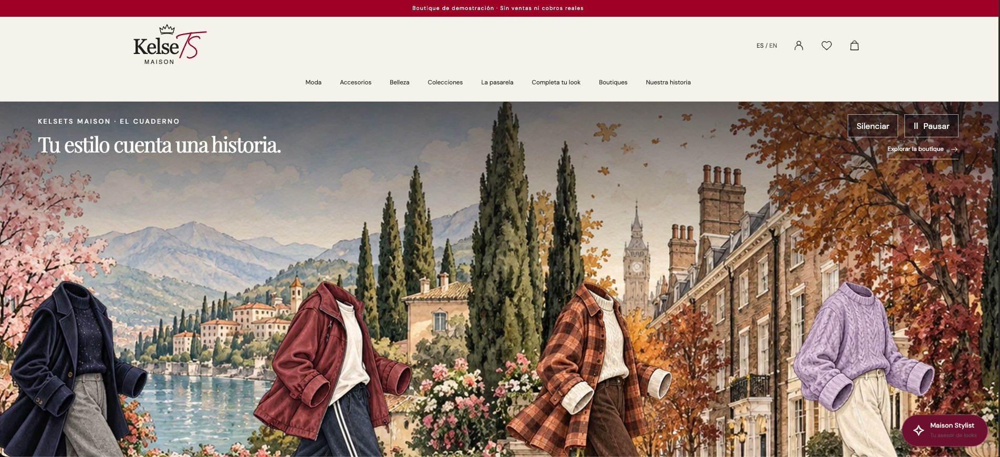

*Escritorio, desktop1.mov, 00:03.* La película y el catálogo comparten identidad visual; el acceso flotante permite encontrar el asesor. Las imágenes de producto son representaciones de una boutique ficticia, no fotografías de mercancía real.

### Figura 2 · Colecciones con menos recorrido vertical

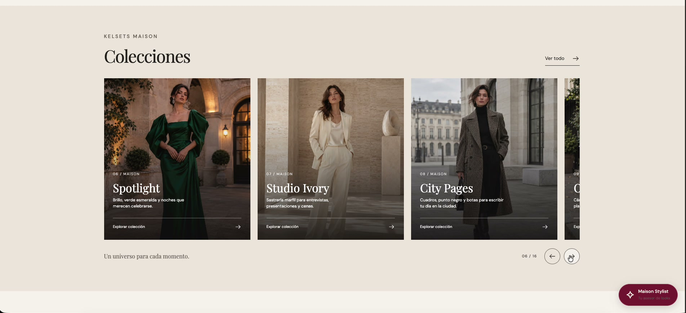

*Escritorio, desktop1.mov, 01:00.* El carrusel organiza dieciséis colecciones con fotografía, descripción y enlace. La posición 06/16 y las flechas hacen visible que existen más opciones. Esta revisión nace de mi prueba de la portada: la cuadrícula anterior requería demasiado scroll.

### Figura 3 · Una experiencia en distintos dispositivos

| iPhone | Android | iPad en inglés |
| --- | --- | --- |
| 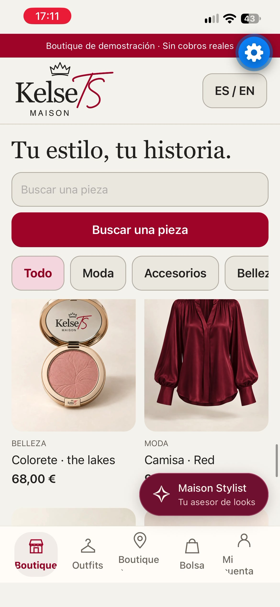 | 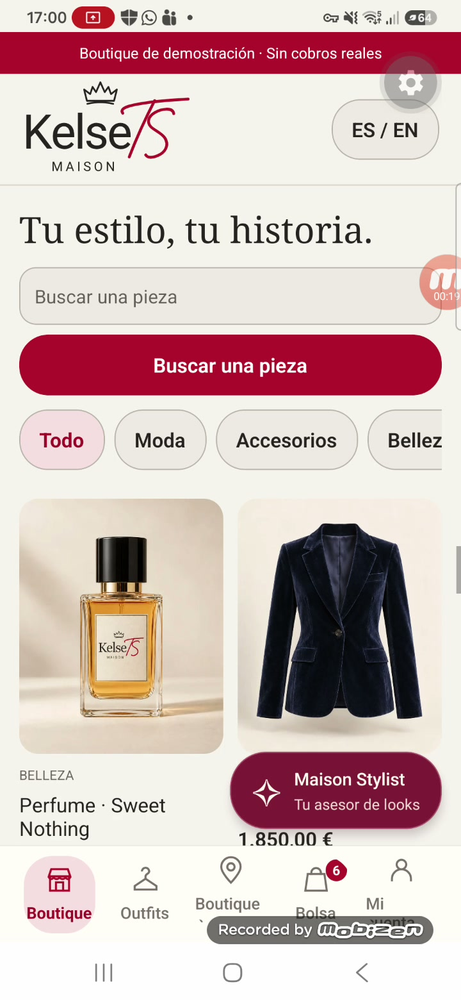 | 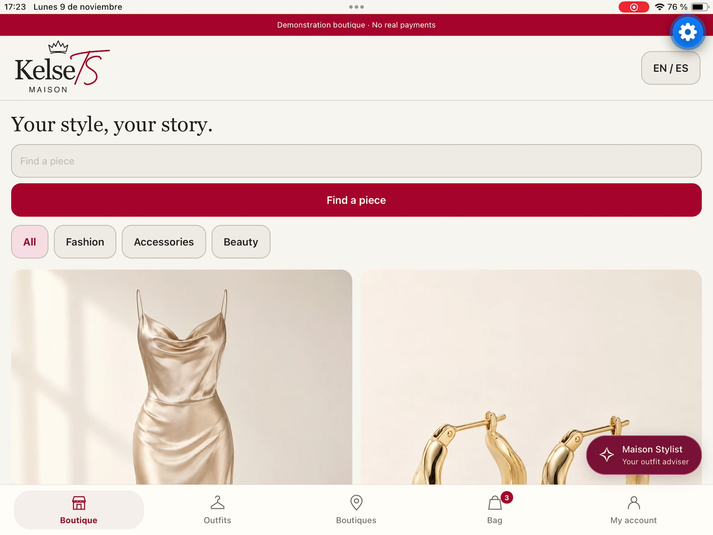 |

*iPhone 00:20; Android 00:20; iPad 01:00, en sus respectivas grabaciones.* Se observan búsqueda, categorías, fotografías y navegación nativa. Esto acredita esas pantallas físicas, no todos los casos de compra, conectividad o accesibilidad. El despliegue móvil sigue siendo de desarrollo en Expo Go y Metro.

### Figura 4 · Conversación vinculada a productos verificables

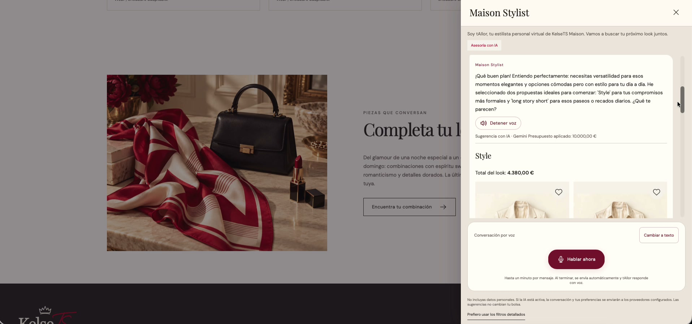

*Escritorio, desktop2.mov, 05:00.* El usuario pide renovar el armario para distintas actividades; tAIlor distingue propuestas formales y cotidianas. Style aparece por 4.380 € dentro de 10.000 €. Los IDs, precios y existencias se comprueban en el servidor: el texto generado no autoriza cambios de precio o permisos. El estado visual de voz no permite evaluar la pronunciación a partir de este fotograma.

### Figura 5 · Seguimiento de la selección en móvil

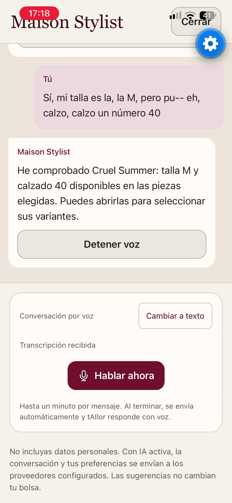

*iPhone, Iphone.MP4, 07:20.* La respuesta conserva Cruel Summer al confirmar M/40. La disponibilidad indicada corresponde al momento de la consulta; no es una reserva ni una garantía de ajuste. Conservo el encuadre original, incluido el solapamiento visible de la cabecera con la barra de estado, sin retocar la captura.

### Figura 6 · Comunicación consultada físicamente en iPhone

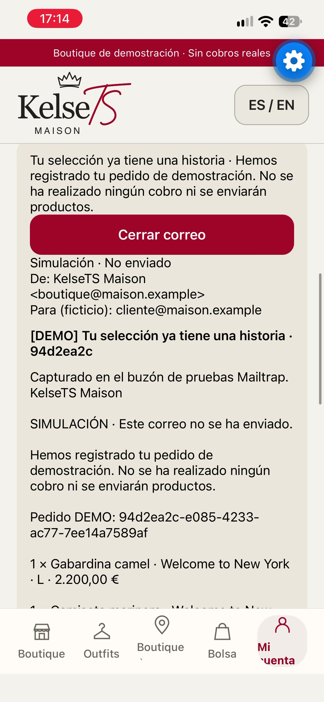

*iPhone, Iphone.MP4, 03:30.* El usuario despliega la compra en Mis comunicaciones y se ve el estado de captura en Mailtrap. He comprobado físicamente esta previsualización en iPhone. El estado Capturado corresponde a la recepción técnica en Sandbox; el destinatario sigue siendo ficticio y no recibe un correo real. La captura conserva también el texto histórico No enviado.

### Figura 7 · Correo recibido desde la API publicada

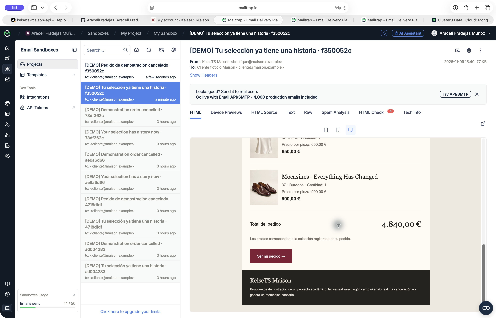

*Safari, Mailtrap Sandbox, API publicada.* Studio Interview reúne cuatro piezas por 4.840,00 €; el justificante de la API acredita cargo real cero. Compra y cancelación del mismo pedido quedaron capturadas y se repuso el stock. Esta prueba tiene un pedido distinto al del vídeo de iPhone: no los presento como un recorrido único. [Registro HTTPS y capturas](docs/evidencias/mailtrap-vercel-2026-11-09/README.md).

### Figura 8 · Probar el reintento y contrastar sus efectos

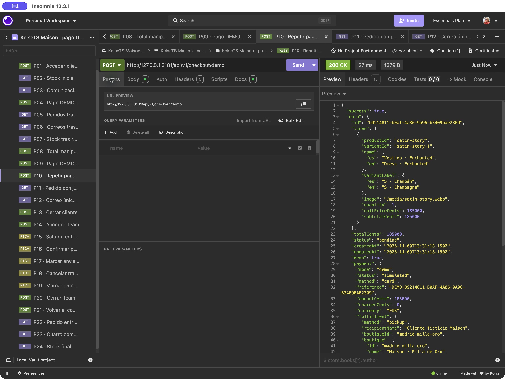

*Insomnia 13.3.1, MongoDB temporal, API loopback 3181.* El reintento devuelve 200 con el mismo pedido. La lectura directa de la base confirma una compra de 1.850,00 €, una comunicación y stock 6 → 5, sin duplicados. Esta base es aislada; no se atribuye el resultado a Atlas. [24 casos, incidencias y contraste](docs/evidencias/insomnia-mongodb-2026-11-09/README.md).

### Figura 9 · Persistencia publicada e índices

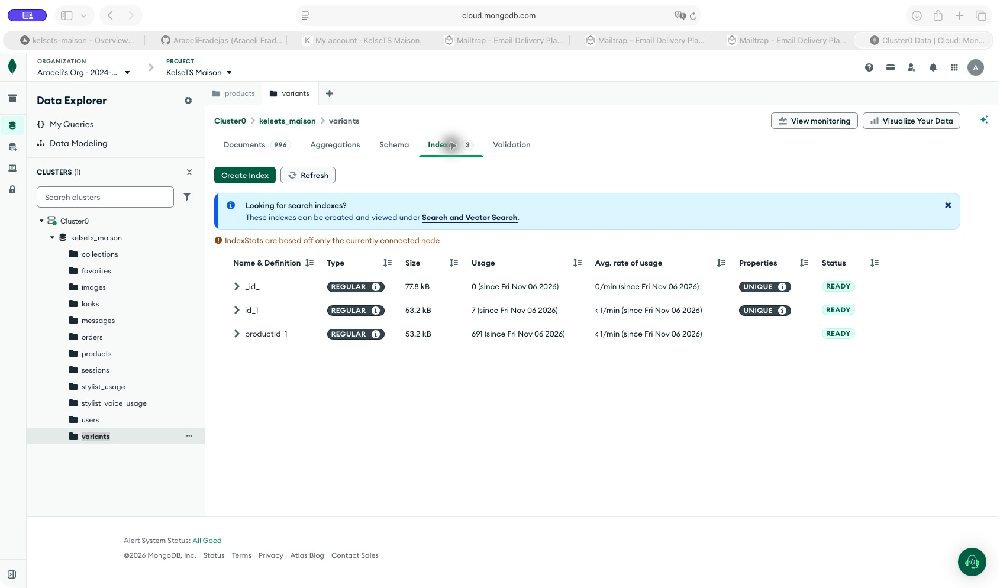

*Safari, Atlas, consulta de solo lectura.* `_id_` e `id_1` son únicos; `productId_1` permite consultar variantes por producto. La pantalla muestra índices READY. He obtenido la captura sin modificar datos ni exponer documentos de usuarios o sesiones. [Catálogo, variantes y límites de la consulta](docs/evidencias/atlas-2026-11-09/README.md).

### Cómo relaciono estas pruebas con el curso

He aplicado las lecciones de responsabilidades, inversión de dependencias, variables de entorno y secretos, autenticación/autorización y mapa de pruebas. Utilizo esos criterios al separar contratos, dominio y transporte; mantener secretos fuera del cliente y Git; comprobar propiedad y roles en backend; y distinguir tests automatizados, API manual, persistencia y observación física. Las imágenes ilustran esos resultados concretos, sin presentar una captura como prueba completa de seguridad o calidad.

## 1. Contexto y motivación

Maison es una nueva historia dentro del Universo KelseTS, la marca ficticia con la que he dado identidad a varios proyectos de mi portfolio. La música, las historias compartidas y el deporte forman parte de su inspiración. En esta boutique aparecen en los nombres de las prendas, en los ambientes de las colecciones y en los pequeños detalles que terminan de unir un look.

Desarrollé AFM Moda Oceánica y KelseTS Cars en otro máster, anterior al de BigSchool. Los incluyo como antecedentes de mi portfolio y de mi aprendizaje; el TFM que presento en este máster es KelseTS Maison.

La moda ya estaba presente en [AFM Moda Oceánica](https://proyecto-landing-page-1.vercel.app/), una landing centrada en presentar una marca y una selección de prendas. Con [KelseTS Cars](https://kelsets-cars.vercel.app) avancé hacia una aplicación full stack con catálogo, cuentas y gestión privada. En Maison he llevado ese aprendizaje a un recorrido de tienda con reglas propias de productos, variantes, existencias y pedidos.

Mi punto de partida fue una situación sencilla: una persona encuentra una prenda que le gusta, pero necesita elegir su talla y descubrir qué accesorios o productos de belleza pueden acompañarla. Quería que la experiencia ayudase a tomar esas decisiones y que el catálogo, el asesor y la bolsa formasen parte de la misma historia.

## 2. Objetivos y alcance de la versión que presento

He construido el recorrido portada → catálogo → ficha → variante → bolsa → pedido de demostración. La cuenta permite consultar pedidos y comunicaciones; en la web también permite guardar favoritos. Desde Team puedo gestionar productos, traducciones, imágenes, variantes, existencias y estados de pedido.

El catálogo reúne **190 artículos y 996 variantes**, organizados en Moda, Accesorios y Belleza. Dieciséis colecciones conectan **21 looks editoriales y 36 outfits de pasarela**. Cada conjunto se compone de piezas del mismo inventario y permite elegirlas por separado o añadirlas con sus variantes.

La web tiene textos en castellano e inglés y diseño responsive. He desarrollado además una app nativa con React Native y Expo que comparte la API HTTPS: catálogo, outfits, sesión, bolsa por cuenta, pago simulado, pedidos, comunicaciones, boutiques y tAIlor. La versión móvil se utiliza con Expo Go y Metro; la administración Team y los favoritos forman parte de la web.

He publicado la web y la API en proyectos separados de Vercel, con MongoDB y Cloudinary propios de Maison. Para facilitar la ejecución local, mantengo un modo SQLite que permite explorar la boutique sin configurar esos servicios externos. La cuenta del evaluador y su contraseña se facilitan de forma privada.

## 3. Organización técnica y reutilización

He mantenido JavaScript y React por continuidad con mis proyectos anteriores. La web utiliza React Router, Vite y CSS; la API utiliza Node.js, Express y Zod. He separado las funcionalidades de acceso, catálogo, pedidos, imágenes, comunicaciones y asesor, y he situado los elementos comunes de interfaz en `shared`.

Los paquetes `contracts` y `api-client` reúnen los esquemas, las reglas compartidas de estados y el transporte HTTP. Así puedo consumir la misma API desde web y móvil sin duplicar decisiones sobre precios, cantidades o permisos. La [arquitectura](docs/ARQUITECTURA.md) explica esta organización.

He revisado y adaptado el transporte HTTP y algunos patrones de organización de KelseTS Cars. También he conservado el logo vectorial de mi marca, ajustándolo a Maison. No he trasladado sus usuarios, datos de producción, credenciales ni historial de Git: Maison tiene repositorio y servicios propios. En [Recursos](docs/RECURSOS.md) documento la reutilización, las herramientas y las licencias.

## 4. Identidad visual, catálogo y pasarela

He elegido marfil, negro suave y rojo KelseTS `#b3152b`, con DM Sans para la interfaz y Playfair Display para los títulos. Sirvo las fuentes desde la propia aplicación. Buscaba una boutique editorial, con imágenes protagonistas, espacio y controles claros, sin perder la facilidad para encontrar una pieza o volver a la bolsa.

Los nombres de los productos y los looks utilizan títulos de canciones de Taylor Swift o referencias inspiradas en ellas. He mantenido visible el tipo de pieza y la coherencia entre castellano e inglés. Es una inspiración creativa; no implica afiliación ni patrocinio.

He sustituido la cuadrícula extensa de colecciones por un carrusel de dieciséis portadas editoriales creadas para esa sección, sin repetir imágenes de los vídeos. Cada tarjeta enlaza a su colección y las imágenes WebP tienen tamaños adaptados. En «Del cuaderno a tu armario» he unido la narrativa de pasarela con las fichas de los looks.

La pasarela ilustrada reúne 36 outfits en un recorrido de noventa segundos. El catálogo de 190 artículos incluye las 139 piezas de estos outfits. Los conjuntos no crean otro inventario ni un precio independiente: al añadirlos, incorporo sus líneas individuales a la bolsa después de elegir una variante disponible de cada pieza.

He utilizado representaciones generadas de los productos ficticios y recursos editoriales propios. Para los clips de campaña he empleado Runway, y FFmpeg para optimizar y montar vídeo. La música «Runway Pulse» la creé en Suno. He revisado encuadres, continuidad y movimientos antes de incorporar las tomas, y he conservado los másteres y fuentes de trabajo fuera de Git. No presento estas imágenes como fotografías de mercancía real.

Los precios de demostración siguen un posicionamiento de lujo. Los he contrastado por categoría con referencias oficiales de Saint Laurent, Gucci y Prada, documentadas en [Precios](docs/PRECIOS.md). Las migraciones conservan las personalizaciones de Team y los importes de pedidos históricos.

## 5. Cuenta, sesión y selección personal

He implementado registro con correo ficticio y contraseña propia, acceso y separación de roles. Las contraseñas se derivan con `scrypt` y sal aleatoria. En la web utilizo una cookie HttpOnly y un token opaco cuyo hash se guarda en la base. En móvil utilizo Expo SecureStore para conservar la sesión sin guardar contraseñas.

La API comprueba la propiedad de los pedidos y las comunicaciones, además del rol de Team. El registro público siempre crea una cuenta de cliente; no permite elegir permisos de administración.

La bolsa conserva identificadores y cantidades, con un espacio por cuenta y otro para visitantes. Al abrirla consulto de nuevo precios y disponibilidad. Los favoritos de la web pertenecen a cada usuario y no se muestran a otras cuentas.

## 6. Pedidos, existencias y pago de demostración

He diseñado el pedido para que el servidor mantenga la autoridad sobre cantidades, precios y existencias. Calculo los totales en céntimos y compruebo cada variante. La creación del pedido, el descuento de stock y su comunicación se realizan dentro de una transacción: si falla una línea, se revierte el conjunto.

He incorporado idempotencia para evitar duplicados ante un doble envío o una respuesta perdida. Una repetición con la misma clave, cuenta y contenido devuelve el pedido anterior; reutilizar esa clave con otro contenido produce un conflicto. Las líneas guardan una copia del nombre, la variante, la imagen y el precio del momento.

El pago es una simulación académica. Puedo escoger cuenta bancaria ficticia, tarjeta ficticia o PayPal simulado; en la app también Apple Pay simulado en iOS y Samsung Pay simulado en Android. No conecto con esos servicios ni solicito datos bancarios. Antes de confirmar acepto el aviso de demostración y el justificante muestra siempre un cargo real de **0,00 €**.

Un resultado rechazado no crea un pedido ni descuenta unidades. Un resultado aceptado registra el pedido en estado pendiente. Desde Team puedo confirmarlo, simular envío y entrega o cancelarlo antes del envío. La cancelación repone las unidades una sola vez y conserva el justificante histórico.

También he protegido la edición del catálogo con una revisión de producto, para que una pantalla antigua de Team no sobrescriba existencias que hayan cambiado por un pedido. Los filtros de talla, precio y disponibilidad se aplican a la misma variante.

## 7. Entrega y boutiques ficticias

He ampliado el checkout con destinatario, domicilio o recogida y una revisión previa al pago. En domicilio guardo calle, código postal, localidad y zona; en recogida guardo la boutique elegida. Solicito datos ficticios.

La demostración contempla la Comunidad de Madrid, Barcelona ciudad y Marbella. La API comprueba el código postal según las reglas de la zona; esta validación no certifica que una dirección exista ni conecta con un transportista. El servidor calcula estimaciones de 3–5 días laborables para domicilio y 1–2 para recogida, con calendario de Madrid, de lunes a viernes y sin ajustar festivos.

He creado Maison · Milla de Oro, Maison · Passeig de Gràcia y Maison · Puerto Banús como boutiques ficticias. Las fotografías acreditadas de Wikimedia Commons muestran sus entornos reales; no son locales de Maison. He utilizado Leaflet y OpenStreetMap en web y `react-native-maps` en la app, con enlaces a Street View.

La ubicación es opcional y se solicita al pulsar el control de distancia. También puedo elegir un punto manual. Calculo kilómetros en línea recta en el cliente, sin guardar la ubicación en la cuenta o el pedido. En Safari he comprobado el punto manual y un pedido de recogida, con las mismas fechas y datos visibles en Team. Después cancelé el pedido y repuse su unidad.

## 8. Comunicaciones ilustradas y Mailtrap Sandbox

He conectado los eventos de registro del pedido, confirmación, envío simulado, entrega simulada y cancelación con comunicaciones ES/EN dentro de la cuenta. Cada mensaje conserva las líneas y los importes del pedido y tiene una previsualización en web y app.

Quería que los correos formasen parte de Maison, en lugar de parecer un aviso técnico. Por eso he incorporado logo, marfil y burdeos, fotografías de las piezas, variantes, cantidades, subtotales y total. En cancelación muestro el importe cancelado sin presentarlo como un reembolso bancario. La aclaración académica queda en el pie.

He utilizado Nodemailer con SMTP restringido a Mailtrap Sandbox. El logo y las miniaturas se adjuntan por CID. El destinatario es ficticio: los mensajes quedan capturados en el buzón de pruebas y no llegan a clientes reales. La comunicación interna y el registro de captura SMTP son estados distintos; un fallo de correo no revierte una compra ya registrada.

He comprobado compra y cancelación en castellano e inglés con Studio Interview, por **4.840,00 €**, con sus cuatro piezas. Al repetir el checkout no se genera otro correo y al cancelar se repone el stock. He guardado capturas reales de escritorio y de la vista móvil emulada de Mailtrap; al encontrar un desbordamiento de nombres, corregí la plantilla y comprobé la nueva muestra.

También he activado y verificado SMTP desde la API publicada en Vercel: compra y cancelación recibidas en Mailtrap, cargo real cero y existencias repuestas. Mi grabación de iPhone muestra la previsualización de compra en Mis comunicaciones. Los registros distinguen esta observación física de la vista móvil emulada del buzón. [Correos y funcionamiento](docs/CORREOS-DEMO.md) · [Muestras ES/EN](docs/evidencias/emails-2026-11-09/README.md) · [Prueba publicada](docs/evidencias/mailtrap-vercel-2026-11-09/README.md).

## 9. Administración Team

Desde Team puedo crear y editar productos, sus textos bilingües, imágenes, variantes y stock, ocultarlos del catálogo y consultar o avanzar pedidos. He incorporado búsqueda por nombre o identificador y filtros de visibles y archivados.

He protegido las subidas comprobando el formato real del archivo. Sharp decodifica, orienta, reduce y convierte las imágenes a WebP; no conservo el original subido. Una variante utilizada en un pedido pendiente o confirmado no puede eliminarse, porque la necesito para reponer existencias si se cancela.

He recorrido la gestión desde la interfaz, incluida la creación de una pieza bilingüe, su imagen, el archivo y la reapertura con los datos guardados. He retirado los datos temporales de las pruebas conservando el catálogo de 190 productos. Las evidencias publicadas también muestran consulta, confirmación y cancelación de pedidos desde Team.

## 10. App nativa con React Native y Expo

He desarrollado una interfaz nativa que comparte la API HTTPS de la web, sin incrustarla en un WebView. Incluye catálogo paginado, búsqueda, categorías, fichas, variantes, outfits, bolsa por cuenta, acceso, pago DEMO, historial, comunicaciones, boutiques y tAIlor en castellano e inglés.

He adaptado los controles, el cambio de idioma y las acciones a iOS y Android, manteniendo la identidad de Maison y una barra inferior propia. La entrada muestra una animación del logo que se puede saltar y respeta la reducción de movimiento. Los importes mantienen **1.850,00 €** en ambos idiomas; los valores internos siguen en céntimos.

He configurado la app con SDK 58 y he comprobado sus exportaciones. Utilizo Expo 58.0.23, React Native 0.88.1, React 19.3.0 y `expo-splash-screen` 58.0.13, con las versiones registradas en el lockfile. He obtenido 20/20 comprobaciones correctas en Expo Doctor.

En iPhone he recorrido registro, acceso, rechazo conservando la bolsa, pedido aceptado con cargo real cero, historial y persistencia de sesión tras cerrar Expo Go. Cancelé el pedido de prueba y repuse sus unidades. En iPad resolví el acceso actualizando el sistema y Expo Go. Mis vídeos documentan catálogo y correo en iPhone, catálogo en inglés y asesor en iPad, y bolsa, checkout y chat por texto en Android. He comprobado además el funcionamiento de voz en iOS y Android.

La app se ejecuta con Expo Go y Metro en el entorno de desarrollo. Un despliegue de Vercel actualiza web y API; los cambios de código nativo se cargan desde Metro. He descrito los pasos de acceso en la [guía móvil](mobile/README.md).

## 11. tAIlor: de la selección editorial a la conversación generativa

He preparado «Completa tu look» con selecciones editoriales manuales según ocasión, paleta, presupuesto y disponibilidad. He integrado también tAIlor para que la persona pueda explicar su plan con naturalidad y recibir propuestas con fotografías y enlaces.

He diseñado la conversación para enviar el mensaje y un contexto acotado al modelo, que devuelve intención y preferencias estructuradas. Así puedo interpretar referencias a un look o una pieza elegidos, pedir complementos y orientar la compra sin reiniciar la selección. He comprobado estos comportamientos con conversaciones reales y pruebas de regresión.

He preparado Gemini → Claude → OpenAI como cadena de proveedores. El backend valida la salida y reconstruye las tarjetas desde identificadores permitidos del catálogo. Comprueba tallas, stock y presupuesto: la IA no fija precios, no modifica permisos y no tiene herramientas para crear pedidos o añadir piezas a la bolsa.

He incorporado seguimiento del look y la pieza elegidos, cambio de objetivo, consulta de tallas, alternativas para completar un outfit e instrucciones de compra. Una referencia como «enséñame las dos» conserva las propuestas actuales; preguntar por zapatos no reinicia la selección de conjuntos. He evitado repetir una pregunta de cierre fija en cada respuesta generativa.

He dado a tAIlor una personalidad cercana, con saludo y presentación como estilista personal virtual de KelseTS Maison. No se hace pasar por una persona. He acotado la conversación a outfits y estilismo, y he añadido controles ante temas ajenos, instrucciones maliciosas, secretos o precios inventados. Estos controles complementan los esquemas, los permisos y la validación del servidor.

He comprobado conversaciones reales con Gemini sobre una cena y la reutilización del conjunto para una entrevista: las referencias se mantienen en los turnos posteriores. También he probado con Gemini y respaldo de Claude la consulta de tallas, una talla mayor y cómo comprar, sin cambiar el look ni crear pedidos. Los registros separan los contextos iniciales simulados de las respuestas reales. [Diseño y pruebas del chat](docs/CHAT-GENERATIVO-TAILOR.md).

He activado el asesor también para visitantes con un máximo global de **100 intentos de modelo por día UTC**, incluidos fallos y respaldos, y cierre al finalizar el **31/12/2026 en Madrid**. El límite cuenta intentos, no euros. Si no hay IA disponible, la interfaz lo explica y los filtros editoriales permanecen como opción separada; no presento una selección manual como respuesta generativa.

## 12. Voz y experiencia de conversación

He añadido la elección entre escribir o hablar. El modo texto no solicita micrófono. Al elegir voz se pide permiso y la grabación comienza con una acción explícita. Cada mensaje admite hasta un minuto; al detener, se transcribe y envía automáticamente, y la respuesta se reproduce una vez. La persona puede detenerla, escucharla de nuevo o cambiar a texto.

He utilizado ElevenLabs para transcripción y síntesis con una voz multilingüe, y los módulos oficiales de audio de Expo en móvil. Las claves permanecen en el backend. He preparado los precios en palabras con euros y céntimos y la pronunciación fonética de los nombres para el texto de síntesis, conservando la escritura de la marca en pantalla.

He comprobado el flujo de finalizar, transcribir y enviar la grabación en Expo Go, tanto en iOS como en Android. He unificado el indicador de espera con un spinner, simplificado la jerarquía de botones y mantenido la conversación al abrir una ficha y volver al asesor durante la misma navegación.

He verificado tres peticiones reales de audio: una frase en castellano, otra en inglés y la transcripción del audio generado, todas con HTTP 200. Las comprobaciones posteriores en dispositivos y las grabaciones complementan esas pruebas de proveedor, con su alcance identificado. [Voz y resultados](docs/VOZ-TAILOR.md).

La voz tiene una cuota global separada de **200 acciones al día UTC**, compartida entre transcripción y síntesis, con la misma caducidad del asesor. Al agotarse, el aviso aparece al intentar usar voz, mediante un tooltip, y se puede seguir escribiendo. No guardo audio en la base de datos de Maison; se utiliza temporalmente para grabar y reproducir y se procesa mediante el proveedor configurado.

## 13. Validación y evidencias de la entrega

He combinado pruebas automáticas, recorridos manuales, consultas directas a las bases y observación física. Identifico el entorno y el alcance de cada registro para distinguir el resultado de una API local, la aplicación publicada y una pantalla en un dispositivo real.

He obtenido **191 comprobaciones automáticas correctas** en la suite documentada: 111 backend, 10 cliente HTTP, 10 web y 60 móvil. He verificado también el build web, las exportaciones iOS/Android y el arranque del build con datos temporales. Estas comprobaciones cubren permisos, privacidad, stock, importes, idempotencia, transiciones de pedido, ediciones antiguas, imágenes, contratos del asesor y errores de correo. [Registro de validación](docs/VALIDACION.md).

En Insomnia he recorrido **24 casos de pago DEMO y estados en SQLite y otros 24 en MongoDB local aislado**, contrastando directamente los efectos en cada base. He comprobado rechazo sin efectos, precio manipulado, compra, reintento, justificante, permisos y transiciones hasta entregado. La lectura final acredita un pedido de 1.850,00 €, cargo real cero, cuatro comunicaciones y stock 6 → 5. He guardado 31 capturas de estas dos rondas. [Colección e instrucciones](docs/api/README.md).

En Atlas he consultado el catálogo, las variantes y los índices únicamente en lectura, con cinco capturas. No he alterado pedidos públicos para ilustrar esos casos ni atribuido a Atlas las pruebas ejecutadas en la réplica local. [Evidencias de Atlas](docs/evidencias/atlas-2026-11-09/README.md).

He completado recorridos de compra en Chrome y Safari sobre la web publicada, cancelando después los pedidos de prueba para restaurar stock. He conservado 39 capturas de escritorio y 29 fotogramas extraídos de mis cinco grabaciones para ilustrar el resultado. Identifico las pantallas emuladas y las capturas físicas, y conservo el encuadre original. [Índice de evidencias](docs/evidencias/README.md).

## 14. Aplicación de lo aprendido en el máster

He utilizado las lecciones como criterios para revisar decisiones concretas. Estas son algunas de las referencias que he aplicado al proyecto:

| Lección y tramo revisado | Criterio aplicado | Resultado en Maison |
| --- | --- | --- |
| [SRP/OCP · solución](https://campus.thebigschool.com/cursos/master-en-desarrollo-con-ia/modulos/buenas-practicas-y-principios-de-diseno/leccion/ejercicio-srp-ocp-solucion-5/), 01:45–14:30 | Diagnosticar responsabilidades y cambiar por pasos comprobables | Textos de estados extraídos a `backend/src/domain/order-messages.js`; MongoDB ya no importa las rutas de pedidos para obtenerlos |
| [DIP · solución](https://campus.thebigschool.com/cursos/master-en-desarrollo-con-ia/modulos/buenas-practicas-y-principios-de-diseno/leccion/ejercicio-dip-solucion-5/), 00:45–07:49 | Hacer explícita una dependencia que impide aislar pruebas | `readConfig(env)` conserva `process.env` por defecto y admite objetos independientes en pruebas |
| [Variables de entorno y secretos](https://campus.thebigschool.com/cursos/master-en-desarrollo-con-ia/modulos/seguridad-env-owasp-top-10/leccion/variables-de-entorno-y-secretos/) | Validar configuración y evitar exposición de secretos | Puerto y protocolo validados; Vercel fuerza producción; mensajes inesperados de proveedores excluidos de los logs |
| [AuthN/AuthZ](https://campus.thebigschool.com/cursos/master-en-desarrollo-con-ia/modulos/seguridad-env-owasp-top-10/leccion/authn-authz-con-tokens-a-mano/) | Distinguir identidad, sesión y permisos sobre recursos | Sesiones revocables conservadas; cookies malformadas descartadas; comprobaciones de propiedad y Team en servidor |
| [TDD con IA](https://campus.thebigschool.com/cursos/master-en-desarrollo-con-ia/modulos/testing/leccion/tdd-con-ia/) | Demostrar primero el fallo y después comprobar la corrección | Cinco casos de configuración/seguridad y tres de cliente HTTP fallaron antes de corregir y pasan después |
| [Mapa de pruebas](https://campus.thebigschool.com/cursos/master-en-desarrollo-con-ia/modulos/testing/leccion/setup-mapa-de-pruebas-front-vs-back/) | Cada nivel demuestra propiedades diferentes | Se separan pruebas de negocio, cliente HTTP, modelos UI, exportación, navegador y dispositivos físicos |

He aplicado esos criterios al separar contratos, dominio y transporte; mantener las claves fuera del cliente y de Git; comprobar roles y propiedad en la API; y probar conflictos de stock, precios e idempotencia. No he cambiado de framework por aparecer en una clase: he priorizado las decisiones que mejoraban el recorrido y podía justificar con resultados.

En la revisión detecté, entre otros problemas, una cookie JSON malformada que afectaba al cierre de sesión y sobres JSON inválidos que el cliente HTTP no distinguía correctamente. Los reproduje con pruebas y corregí su tratamiento. También separé los textos de estados en una política compartida y adapté la configuración para probarla sin modificar variables globales.

Con tAIlor he aprendido a distinguir una respuesta que parece natural de una conversación que conserva realmente sus referencias. Las pruebas de selección, tallas, complementos y compra me han servido para revisar el contexto y mantener la autoridad del backend, sin dar herramientas de escritura al modelo.

## 15. Dificultades y aprendizajes

La disponibilidad fue una dificultad transversal: un artículo puede agotarse mientras se consulta y Team puede conservar una pantalla antigua. He resuelto el problema con transacciones, idempotencia, control de revisión y mensajes que permiten corregir la bolsa, en lugar de confiar en lo que muestra el cliente.

La app me ha obligado a diferenciar una web responsive de una interfaz nativa. Compatibilidad de SDK, almacenamiento seguro de sesión, permisos de micrófono y envío de audio requieren comprobaciones propias. Compartir contratos y API me ha permitido conservar las reglas de negocio sin forzar la misma interfaz en ambas plataformas.

También he aprendido a cuidar la comunicación visual fuera del catálogo. Los correos necesitaban el mismo logo, fotografías y tono que la boutique, y el asesor necesitaba botones con jerarquía clara, continuidad y respuestas adecuadas al contexto. Una vez más, las pruebas reales me han dado información que no aparecía al comprobar solo el build.

Maison representa mi evolución desde una landing hacia un producto full stack con experiencia editorial, app y asistencia generativa. Lo que más valoro es haber conectado la parte creativa con reglas verificables: una historia visual puede atraer, pero la confianza depende de que la talla, el importe, el stock y el pedido sigan siendo coherentes.

## 16. Recursos, autoría y acceso

He mantenido el código, las instrucciones de instalación y las evidencias en el [repositorio de Maison](https://github.com/AraceliFradejas/BigSchool-TFM_KelseTSMaison). Los vídeos originales, documentos de trabajo, credenciales y datos privados permanecen fuera de Git. Facilito por separado la cuenta de evaluación y los materiales audiovisuales de la defensa.

KelseTS es mi marca ficticia. Maison es un proyecto académico y de portfolio, sin actividad comercial ni afiliación, patrocinio o respaldo de celebridades, marcas o entidades deportivas. Los productos, precios y operaciones son ficticios; no realizo cobros, entregas físicas ni reembolsos bancarios. Los créditos, licencias y herramientas utilizados están registrados en [Recursos](docs/RECURSOS.md).

### Mis redes

[GitHub](https://github.com/AraceliFradejas) · [LinkedIn](https://www.linkedin.com/in/araceli-fradejas-munoz-transformaciondigital/) · [X](https://x.com/AraceliFradejas) · [Medium](https://medium.com/@araceli.fradejas) · [YouTube](https://www.youtube.com/@aracelifradejasmunoz2758)
