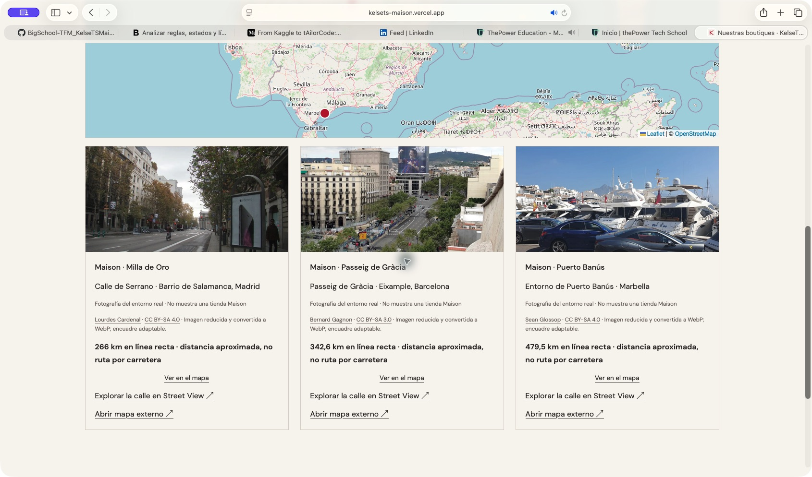
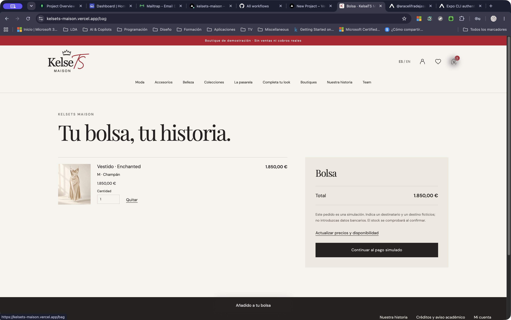
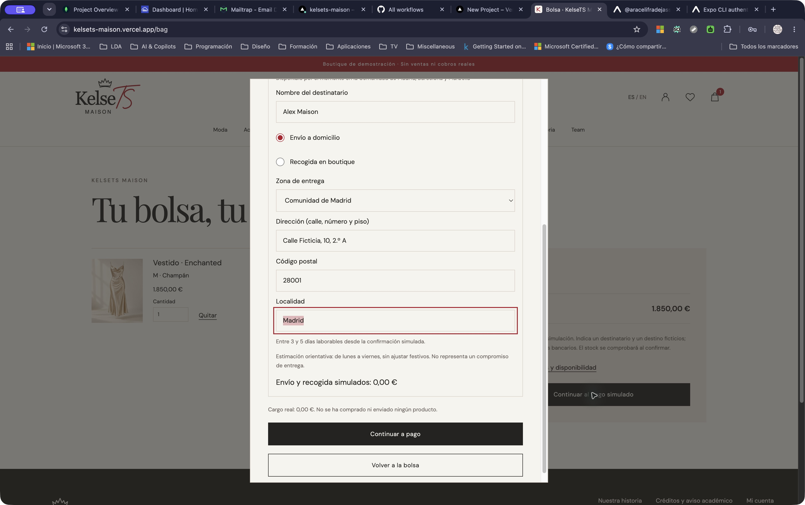
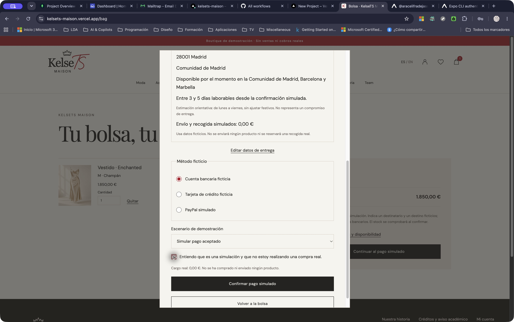
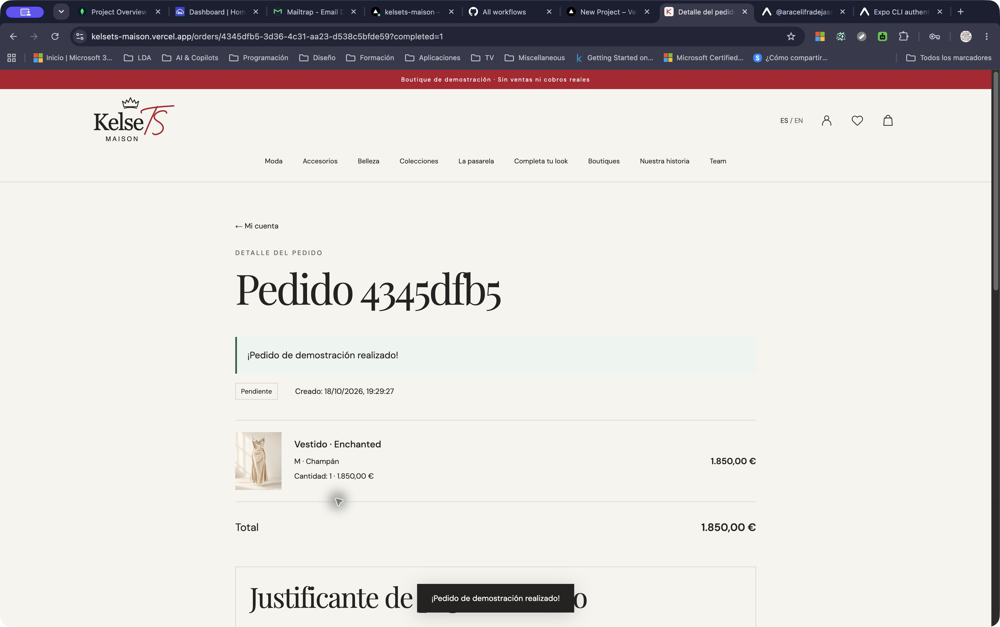
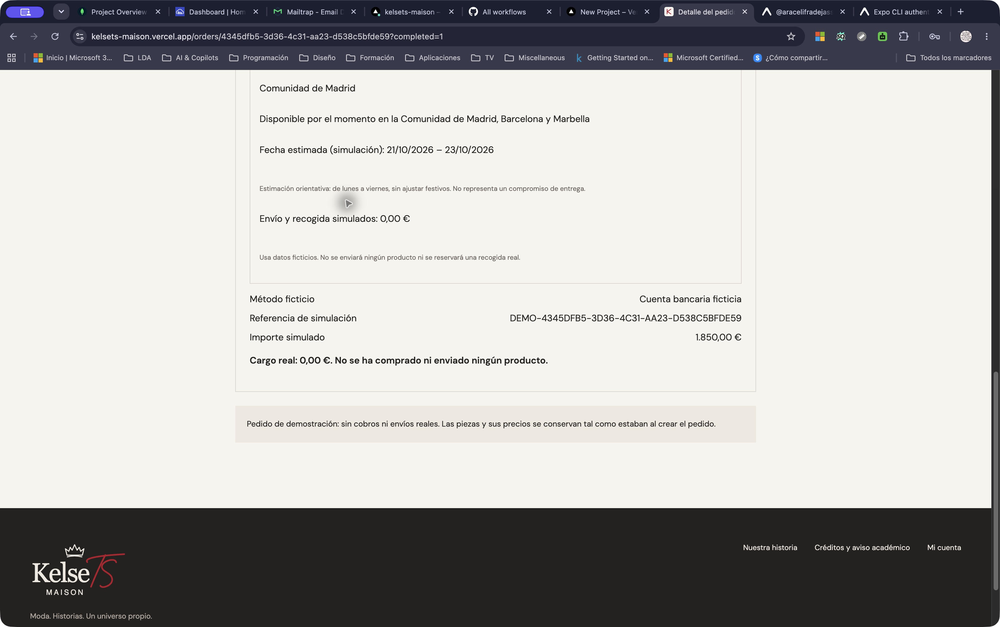

# KelseTS Maison

[Versión en castellano](#versión-en-castellano) · [English version](#english-version)

## Versión en castellano

Proyecto TFM del máster de BigSchool: KelseTS Maison, boutique ficticia de moda, accesorios y belleza desarrollada con React y Node.js.

**Autora: Araceli Fradejas Muñoz.**

> **Tu estilo cuenta una historia.**

KelseTS Maison es una boutique ficticia de moda, accesorios y belleza. Puedes explorar sus colecciones, elegir una variante, guardar tus piezas favoritas y completar un pedido de demostración. No se realizan ventas, cobros ni envíos reales.

**Web:** [Abrir KelseTS Maison](https://kelsets-maison.vercel.app) · **API:** [Comprobar el servicio](https://kelsets-maison-api.vercel.app/api/v1/health).

**Estado:** primera versión publicada en [Vercel](https://kelsets-maison.vercel.app), con MongoDB y Cloudinary propios. La presentación final y las ampliaciones siguen pendientes.

### Una historia personal

Maison continúa Universo KelseTS, la marca ficticia con la que he dado identidad a varios proyectos de mi portfolio. La música, las historias compartidas y el deporte forman parte de su inspiración. Aquí aparecen en una selección para un concierto, en una tarde tranquila o en los detalles que terminan de unir un look.

Después de la landing AFM Moda Oceánica y del recorrido full stack de KelseTS Cars, quería llevar esa experiencia hacia una boutique. Una pieza puede gustarte por sí sola, pero elegir su variante y encontrar otras que encajen requiere un recorrido claro. Esa es la idea que organiza Maison.

### Qué puedes hacer

- Ver una pasarela ilustrada de 36 looks, con escenarios, música y controles de reproducción, y explorar dieciséis colecciones propias.
- Consultar 190 artículos con 996 variantes, incluidas las 139 piezas de los 36 looks de la pasarela.
- Explorar 21 looks editoriales y los 36 outfits de la película; elegir piezas por separado o añadir el conjunto con sus tallas.
- Consultar Moda, Accesorios y Belleza con búsqueda, filtros de talla y precio máximo por pieza, orden por precio y paginación. Al volver desde una ficha se conservan los filtros.
- Descubrir piezas con nombres de canciones de Taylor Swift o inspirados en ellas, como Enchanted, Daylight y cardigan.
- Elegir variantes y comprobar su precio y disponibilidad.
- Registrarte, acceder y guardar productos en «Mi selección».
- Preparar una bolsa y crear pedidos de demostración; consultar su historial, detalle y comunicaciones.
- Buscar combinaciones editoriales según ocasión, paleta, presupuesto y preferencia de incluir belleza.
- Gestionar productos, textos ES/EN, imágenes, variantes y stock desde Team; buscar por nombre o identificador, filtrar visibles y archivados y avanzar o cancelar pedidos según las transiciones permitidas.
- Cambiar entre castellano e inglés conservando la ruta y la bolsa.

El pago es una simulación académica: puedo elegir una cuenta bancaria ficticia, tarjeta ficticia o PayPal simulado; en la app también Apple Pay simulado en iOS o Samsung Pay simulado en Android. Antes de confirmar acepto el aviso de que no compro nada. El justificante DEMO indica un cargo real de **0,00 €**. No hay pasarela, SDK de pagos, campos de datos bancarios ni conexión con esos servicios. Puedo simular un rechazo sin crear pedido ni descontar stock.

«Completa tu look» utiliza selecciones manuales y disponibilidad real del catálogo. Está identificado como **modo editorial, sin IA**. Maison Stylist con un proveedor de IA sigue pendiente. La [app nativa](mobile/README.md) incorpora catálogo, variantes, outfits musicales, bolsa por cuenta, acceso, historial y comunicaciones. He probado la apertura en iPhone, iPad y Android; todavía tengo que validar el nuevo recorrido privado en los dispositivos.

### Entrega y boutiques de demostración

He ampliado el checkout de web y app con destinatario, envío a domicilio o recogida y revisión de entrega antes del pago simulado. Por el momento limito el domicilio a la Comunidad de Madrid, Barcelona ciudad y Marbella, con validación del código postal según la zona elegida. No se comprueba que exista una dirección real y solicito datos ficticios.

Las boutiques son **Maison · Milla de Oro** (entorno de Serrano, Madrid), **Maison · Passeig de Gràcia** (Barcelona) y **Maison · Puerto Banús** (Marbella). Son espacios ficticios, sin locales ni acuerdos con tiendas reales. La portada presenta «Nuestras primeras boutiques» y enlaza a `/boutiques`, también disponible en el menú; la app incorpora una pestaña Boutiques, con mapa, fotos acreditadas del entorno y enlaces a Street View. La distancia se calcula en línea recta en el dispositivo, con ubicación opcional o un punto elegido en el mapa; no se guarda en la cuenta ni en el pedido.

El pedido conserva el destinatario, la dirección o boutique elegida y fechas estimadas calculadas por el servidor: 3–5 días laborables para domicilio y 1–2 para recogida, usando el calendario de Madrid, de lunes a viernes y sin ajustar festivos. Son estimaciones de demostración; envío, recogida y cargo real siguen siendo 0,00 €. Los pedidos anteriores permanecen sin datos de entrega añadidos retrospectivamente.

### App móvil · iPhone, iPad y Android

`mobile/` contiene una aplicación **React Native con Expo**, conectada a la misma API HTTPS de Maison. Incluye catálogo paginado, búsqueda y categorías, ficha con variantes, 36 outfits con títulos de canciones y filtro por era, selección de todas las piezas del conjunto y bolsa local con imágenes de producto. La interfaz es ES/EN y los importes conservan el formato europeo **1.850,00 € en ambos idiomas**.

La entrada muestra el logo animado a pantalla completa, se puede saltar y respeta la reducción de movimiento. Los controles incorporan botones del sistema, selección de idioma propia de cada plataforma y una barra inferior personalizada. No se utiliza un WebView.

Desde la raíz:

```sh
npm ci
npm run mobile
```

Abre el QR en Expo Go con móvil/tablet y ordenador en la misma Wi-Fi. En iPhone/iPad utiliza la misma cuenta Expo en la app y en la CLI (`npx expo login`). La [guía móvil](mobile/README.md) recoge instalación, descarga oficial Android y límites de Expo Go.

**Pruebas en mis dispositivos · 18 de octubre de 2026**

| Plataforma    | Estado observado                                                           | Modelo, versión del sistema y Expo Go                    |
| ------------- | -------------------------------------------------------------------------- | -------------------------------------------------------- |
| iPhone · iOS  | Apertura e interfaz/entrada corregida confirmadas                          | iPhone 13 · iOS 26.6.1 · Expo Go 57.0.9                  |
| iPad · iPadOS | Apertura e interfaz/entrada corregida confirmadas                          | iPad de 6.ª generación · sistema 17.7.0 · Expo Go 57.0.9 |
| Android       | Apertura confirmada; vuelve a cargar tras reiniciar Metro con caché limpia | Samsung Galaxy A34 · Android 16 · Expo Go 57.0.9         |

He comprobado la apertura en estos tres dispositivos. Me queda completar el recorrido de outfits y bolsa, registrar capturas nativas y revisar la conservación de la bolsa, la accesibilidad y los cambios de conexión en cada uno. El acceso, registro, historial y comunicaciones ya están implementados, junto con el checkout simulado y las boutiques; tengo pendiente probar estas ampliaciones en los tres dispositivos. Favoritos, gestión Team e IA siguen pendientes en la app. No hay publicación en tiendas ni binario de distribución.

**Versiones del proyecto comprobadas en el lockfile:** Maison móvil 0.1.0, Expo 57.0.30 (SDK 57), React Native 0.86.3, React 19.2.3 y expo-splash-screen 57.0.10. He registrado estas versiones para reproducir el entorno de desarrollo. Exportación iOS/Android y Expo Doctor 21/21 correctos. Los detalles de las verificaciones y los avisos de dependencias están en [Validación](docs/VALIDACION.md) y en la guía móvil.

### Estructura y tecnologías

La web utiliza React, React Router, Vite y CSS. La API utiliza Node.js, Express, Zod y cookies de sesión. La publicación utiliza MongoDB y Cloudinary propios, siguiendo el patrón de Cars; SQLite mediante `node:sqlite` conserva el modo local sin servicios externos. Sharp valida y optimiza las imágenes subidas desde Team. Los esquemas y las reglas de pedidos están en un paquete compartido; las peticiones pasan por un cliente HTTP independiente de React.

```text
backend/
  src/modules/       # Acceso, catálogo, pedidos e imágenes
  src/db.js          # Tablas, transacciones y semilla
  scripts/           # Semilla y concesión local de acceso a Team
  test/              # Pruebas de API y reglas de tienda
frontend/
  src/app/           # Rutas, navegación y acceso a pantallas privadas
  src/features/      # Catálogo, cuenta, bolsa, Team y marca
  src/shared/        # Estado, idiomas, componentes y peticiones
  src/styles/        # Diseño y responsive
  public/media/      # Imágenes de catálogo WebP y SVG históricos
mobile/              # App nativa React Native y Expo
packages/
  contracts/         # Esquemas y transiciones de pedidos
  api-client/        # Transporte HTTP y sus pruebas
data/catalog.js      # Catálogo y looks ficticios reproducibles
docs/                # Arquitectura, recursos, validación y entrega
scripts/             # Arranque, recursos y migración de imágenes
```

La instalación descrita utiliza SQLite y almacenamiento local. Para MongoDB y Cloudinary, configura los servicios propios y ejecuta `npm run seed:mongo` siguiendo [Despliegue](docs/DESPLIEGUE.md). La base local permite probar Maison sin cuentas de servicios externos. Es independiente de Cars y no contiene sus usuarios, datos ni credenciales. En Node 22, `node:sqlite` muestra un aviso de funcionalidad experimental; el entorno comprobado está recogido en [Validación](docs/VALIDACION.md).

### Instalación local

1. Clona el repositorio:

   ```bash
   git clone https://github.com/AraceliFradejas/BigSchool-TFM_KelseTSMaison.git
   cd BigSchool-TFM_KelseTSMaison
   ```

2. Utiliza Node.js 22, versión 22.13 o posterior dentro de esa rama, e instala:

   ```bash
   npm ci
   ```

3. Arranca la aplicación:

   ```bash
   npm run dev
   ```

Abre **http://127.0.0.1:5173**. La API está en **http://127.0.0.1:3000/api/v1/health**. La primera ejecución crea automáticamente la base y carga los productos que falten. `npm run seed` permite repetir esa carga sin reiniciar existencias ni sobrescribir las ediciones.

Los valores por defecto sirven para el arranque local. Para personalizarlos, copia `backend/.env.example` a `backend/.env`. La plantilla prepara MongoDB y Cloudinary; para seguir sin servicios externos cambia `DATABASE_PROVIDER=sqlite` y `MEDIA_STORAGE=local`. La base, las sesiones y las imágenes subidas se guardan en `backend/runtime/`, fuera de Git. No elimines esa carpeta si quieres conservar tus pedidos y cuentas.

Para revisar el build sin Vite:

```bash
npm run build
npm start
```

En ese caso, abre **http://127.0.0.1:3000**. Si vas a modificar datos desde esta dirección, configura previamente `APP_ORIGIN=http://127.0.0.1:3000` en `backend/.env`.

### Actualizar una instalación anterior

Las instalaciones nuevas ya incluyen el catálogo actual. Para una base local anterior, estos comandos actualizan los valores originales sin sobrescribir las personalizaciones de Team ni los pedidos históricos.

| Comando                         | Actualización                                                                                |
| ------------------------------- | -------------------------------------------------------------------------------------------- |
| `npm run media:migrate`         | Recursos de catálogo; conserva imágenes personalizadas, stock y pedidos.                     |
| `npm run prices:migrate`        | Precios iniciales de lujo; conserva precios personalizados y pedidos.                        |
| `npm run runway:names:migrate`  | Títulos musicales de pasarela; conserva personalizaciones e históricos.                      |
| `npm run catalog:names:migrate` | Los 51 nombres iniciales de producto; conserva traducciones personalizadas, stock y pedidos. |

### Cuenta de prueba y Team

En MongoDB también puedes configurar `ADMIN_EMAIL` y una contraseña propia en `ADMIN_PASSWORD` dentro del `.env` privado y ejecutar `npm run team:create`. Es una acción explícita: no se ejecuta al arrancar ni publica credenciales, y no modifica una cuenta que ya exista.

Puedes registrarte con un correo ficticio y una contraseña propia de al menos diez caracteres. No se envían correos externos. Las cuentas nuevas siempre tienen el rol de cliente; no existen contraseñas ni cuentas administradoras predefinidas en el código.

Para dar acceso a Team a una cuenta que hayas registrado en tu instalación:

```bash
npm run team:grant -- correo-registrado@example.test
```

Recarga la web después del cambio. El comando solo actúa sobre tu base local o la base configurada para esa ejecución. Requiere acceso al servidor; el rol no se puede elegir durante el registro público.

### Pedidos y comunicaciones

El servidor calcula los totales en céntimos y comprueba cada variante. El stock se descuenta al crear el pedido dentro de una transacción: si falla una pieza, se revierte el conjunto. Reenviar el mismo pedido con su misma clave no descuenta existencias de nuevo ni duplica la comunicación.

Team puede confirmar, simular el envío y marcar la entrega. También puede cancelar un pedido pendiente o confirmado, recuperando sus unidades una sola vez. Las líneas conservan nombre, imagen, variante y precio aunque después cambie el catálogo. Las comunicaciones permanecen dentro de la cuenta y tienen textos ES/EN.

La bolsa permite actualizar precios y disponibilidad. Si faltan unidades, indica la pieza afectada y permite ajustar su cantidad; el pedido permanece bloqueado hasta resolverla. Los filtros de talla, precio y disponibilidad se aplican a la misma variante.

### Pruebas y evidencias

```bash
npm test
npm run build
npm run check:production
```

Las pruebas prioritarias cubren permisos, privacidad, stock, totales, pedidos duplicados, estados, ediciones desactualizadas e imágenes. También comprueban la configuración de producción y una copia/restauración local con datos ficticios. `check:production` sirve el build real con datos temporales; no equivale a un despliegue HTTPS público. Las últimas 67 comprobaciones automáticas han pasado. Las verificaciones ejecutadas y sus límites están en [Validación](docs/VALIDACION.md). He recorrido la compra publicada en Chrome y Safari; las capturas conservan los pasos y los datos ficticios utilizados.

### Capturas de la web publicada

Esta selección muestra la web publicada y el recorrido de compra. Puedes abrir cada captura a tamaño completo. El [índice de producción](docs/evidencias/produccion-2026-10-18/README.md) conserva las 39 capturas y explica sus límites. Son capturas de escritorio de Chrome y Safari, no capturas nativas del móvil. He cancelado los pedidos de prueba para reponer el stock.

**Portada en castellano**

<a href="docs/evidencias/produccion-2026-10-18/01-portada-es.jpg"></a>

**Catálogo de la boutique**

<a href="docs/evidencias/produccion-2026-10-18/02-catalogo-es.jpg"></a>

**Boutiques ficticias, mapa y distancias**

<a href="docs/evidencias/produccion-2026-10-18/24-boutiques-mapa-distancias-safari.jpg"></a>

**Bolsa con imagen y variante**

<a href="docs/evidencias/produccion-2026-10-18/29-compra-bolsa-chrome.jpg"></a>

**Destinatario y domicilio ficticios**

<a href="docs/evidencias/produccion-2026-10-18/31-compra-domicilio-ficticio-chrome.jpg"></a>

**Revisión del pago simulado**

<a href="docs/evidencias/produccion-2026-10-18/32-compra-revision-pago-ficticio-chrome.jpg"></a>

**Confirmación del pedido de demostración**

<a href="docs/evidencias/produccion-2026-10-18/33-compra-confirmacion-chrome.jpg"></a>

**Justificante con cargo real cero**

<a href="docs/evidencias/produccion-2026-10-18/35-compra-referencia-cargo-cero-chrome.jpg"></a>

### Despliegue y entrega

Maison está publicada en **[kelsets-maison.vercel.app](https://kelsets-maison.vercel.app)**, con [API propia](https://kelsets-maison-api.vercel.app/api/v1/health), MongoDB y Cloudinary. La web y la API son proyectos separados de Vercel y `/api` se sirve a través del proxy de la web. El 18 de octubre se comprobaron por HTTPS el catálogo, recursos, cabeceras, permisos y un recorrido HTTP de Team con imagen y pedido temporales. Además he completado recorridos de compra simulada desde Chrome y Safari, documentados en las capturas. La apertura de la app está comprobada en mis dispositivos; el nuevo recorrido privado móvil sigue pendiente. El [documento de despliegue](docs/DESPLIEGUE.md) recoge configuración y límites. `npm run check:deployment -- https://kelsets-maison.vercel.app` repite el chequeo de solo lectura. El Dockerfile conserva la alternativa local con SQLite, pendiente de probar en Docker.

La entrega del TFM reunirá código, README, acceso a la aplicación y slides. El [seguimiento de entrega](docs/ENTREGA.md) distingue lo realizado de lo pendiente; la presentación final no está generada todavía.

### Documentación

- [Memoria del proyecto](MEMORIA.md).
- [Arquitectura y reglas de tienda](docs/ARQUITECTURA.md).
- [Validación](docs/VALIDACION.md) y [evidencias](docs/evidencias/README.md).
- [Recursos y reutilización](docs/RECURSOS.md).
- [Criterio de precios de lujo y actualización](docs/PRECIOS.md).
- [Despliegue](docs/DESPLIEGUE.md) y [seguimiento de entrega](docs/ENTREGA.md).

### Mis proyectos y redes

[AFM Moda Oceánica](https://proyecto-landing-page-1.vercel.app/) · [KelseTS Cars](https://kelsets-cars.vercel.app)

[GitHub](https://github.com/AraceliFradejas) · [LinkedIn](https://www.linkedin.com/in/araceli-fradejas-munoz-transformaciondigital/) · [X](https://x.com/AraceliFradejas) · [Medium](https://medium.com/@araceli.fradejas) · [YouTube](https://www.youtube.com/@aracelifradejasmunoz2758)

### Aviso académico y autora

KelseTS es una marca ficticia de **Araceli Fradejas Muñoz**. Maison es un proyecto educativo y de portfolio, sin actividad comercial, afiliación, patrocinio ni respaldo de celebridades, marcas o entidades deportivas. Sus productos, colecciones, precios y operaciones son ficticios. Las imágenes fotorrealistas del catálogo son representaciones generadas de productos ficticios, no fotografías de mercancía real. Los créditos y licencias de las tipografías están en [Recursos](docs/RECURSOS.md).

---

## English version

Full stack project for the **BigSchool final project**, created by **Araceli Fradejas Muñoz**.

> **Your style tells a story.**

KelseTS Maison is a fictional fashion, accessories and beauty boutique. Explore its collections, choose a variant, save favourite pieces and complete a demonstration order. There are no real sales, payments or shipments.

**Website:** [Open KelseTS Maison](https://kelsets-maison.vercel.app) · **API:** [Check the service](https://kelsets-maison-api.vercel.app/api/v1/health).

**Status:** first version published on [Vercel](https://kelsets-maison.vercel.app), with Maison MongoDB and Cloudinary services. The final presentation and extensions are still pending.

### A personal story

Maison continues the KelseTS universe, the fictional brand that gives several projects in my portfolio their personal identity. Music, shared stories and sport are part of its inspiration. Here they appear in a selection for a concert, a quiet afternoon or the details that bring a look together.

After the AFM Moda Oceánica landing page and the full stack journey of KelseTS Cars, I wanted to bring that experience to a boutique. You can love a piece on its own, but choosing a variant and finding complementary pieces needs a clear journey. That idea shapes Maison.

### What you can do

- Watch the illustrated runway with 36 looks, music and playback controls, enjoy a full-height mobile hero, and explore sixteen original collections.
- Browse 190 products with 996 variants, including the 139 pieces of the 36 runway outfits.
- Explore 21 editorial looks and the 36 film outfits; choose separate pieces or add the complete outfit with individual sizes.
- Browse Fashion, Accessories and Beauty with search, size and maximum price filters, price sorting and pagination. Returning from a product keeps the catalogue filters.
- Discover pieces named after or inspired by Taylor Swift songs, including Enchanted, Daylight and cardigan.
- Choose variants and check their prices and availability.
- Register, sign in and save products to “My selection”.
- Prepare a bag, create demonstration orders and view their history, details and messages.
- Find editorial combinations by occasion, palette, budget and whether to include beauty.
- Manage products, ES/EN text, images, variants and stock in Team; search by name or identifier, filter visible and archived products, and advance or cancel orders through allowed transitions.
- Switch between Spanish and English while keeping your route and bag.

Payment is an academic simulation: fictional bank account, fictional card or simulated PayPal, plus simulated Apple Pay on iOS or Samsung Pay on Android. Before confirming I acknowledge that no purchase takes place. The DEMO receipt shows a real charge of **0,00 €**. There is no payment gateway, payment SDK, banking-data form or connection to these services. A simulated decline creates no order and changes no stock.

“Complete your look” uses manual selections and actual catalogue availability. It is labelled **editorial mode, without AI**. Maison Stylist with an AI provider remains pending. The [native app](mobile/README.md) includes catalogue, variants, musical outfits, a bag per account, sign-in, order history and messages. I have opened it on iPhone, iPad and Android; I still need to validate the new private flow on physical devices.

### Demonstration delivery and boutiques

I have extended web and native checkout with a recipient, home delivery or boutique collection, and a delivery review before simulated payment. Home delivery is currently limited to the Community of Madrid, Barcelona city and Marbella, using postcode rules for the selected area. The form requests fictional data and does not verify whether an address actually exists.

The boutiques are **Maison · Milla de Oro** (Serrano surroundings, Madrid), **Maison · Passeig de Gràcia** (Barcelona) and **Maison · Puerto Banús** (Marbella). They are fictional spaces with no physical premises or agreements with real shops. The homepage introduces “Our first boutiques” and links to `/boutiques`, also available in the menu. The app includes a Boutiques tab with maps, credited neighbourhood photographs and Street View links. Optional location or a manually selected map point is used locally for straight-line distances; it is not saved in an account or order.

The order preserves the recipient, address or boutique and server-calculated estimates: 3–5 working days for home delivery and 1–2 for collection, using Madrid’s calendar, Monday to Friday without holiday adjustments. Delivery, collection and the real charge remain **0,00 €**. Earlier orders are not retroactively assigned delivery details.

### Native app · iPhone, iPad and Android

`mobile/` contains a **React Native/Expo** app using Maison’s published HTTPS API. It includes catalogue search, categories, variants, 36 song-named outfits with era filters, complete outfit selections, product images in the bag, sign-in, registration, a bag per account, simulated checkout, order history, messages and boutiques. Both languages use European amounts such as **1.850,00 €**.

The full-screen animated logo introduction is skippable and respects reduced motion. Platform controls and a custom bottom navigation support iOS and Android. The app does not use a WebView.

From the repository root:

```bash
npm ci
npm run mobile
```

Open the QR in Expo Go with the device and computer on the same Wi-Fi. On iPhone/iPad, use the same Expo account in the app and CLI (`npx expo login`). The [mobile guide](mobile/README.md) covers setup, the official Android download and Expo Go limitations.

**My device checks · 18 October 2026**

| Platform      | Observed result                                          | Device, system and Expo Go                             |
| ------------- | -------------------------------------------------------- | ------------------------------------------------------ |
| iPhone · iOS  | App opened; corrected introduction and interface checked | iPhone 13 · iOS 26.6.1 · Expo Go 57.0.9                |
| iPad · iPadOS | App opened; corrected introduction and interface checked | iPad (6th generation) · system 17.7.0 · Expo Go 57.0.9 |
| Android       | App opened and loaded again after clearing Metro’s cache | Samsung Galaxy A34 · Android 16 · Expo Go 57.0.9       |

I still need to complete outfit and bag checks, capture native screenshots, and test persistence, accessibility and connection changes on each device. Sign-in, registration, history, messages, simulated checkout and boutiques are implemented, but these extensions still need physical-device checks. Native favourites, Team management and AI remain pending. There are no distribution binaries or app-store releases.

**Project versions recorded in the lockfile:** mobile app 0.1.0, Expo 57.0.30 (SDK 57), React Native 0.86.3, React 19.2.3 and expo-splash-screen 57.0.10. iOS/Android exports and Expo Doctor 21/21 passed. These checks are separate from physical-device testing; see [Validation](docs/VALIDACION.md).

### Structure and technologies

The web uses React, React Router, Vite and CSS. The API uses Node.js, Express, Zod and session cookies. Deployment uses Maison’s own MongoDB and Cloudinary services, following the Cars pattern; SQLite through `node:sqlite` retains the local mode without external services. Sharp validates and optimises Team image uploads. Schemas and order rules live in a shared package; requests use an HTTP client independent of React.

```text
backend/
  src/modules/       # Authentication, catalogue, orders and images
  src/db.js          # Tables, transactions and seed
  scripts/           # Seed and local Team access
  test/              # API and shop-rule tests
frontend/
  src/app/           # Routes, navigation and protected pages
  src/features/      # Catalogue, account, bag, Team and brand
  src/shared/        # State, languages, components and requests
  src/styles/        # Design and responsive layout
  public/media/      # WebP catalog images and historical SVGs
mobile/              # React Native and Expo app
packages/
  contracts/         # Schemas and order transitions
  api-client/        # HTTP transport and its tests
data/catalog.js      # Reproducible fictional catalogue and looks
docs/                # Architecture, resources, validation and delivery
scripts/             # Startup, assets and image migration
```

The local installation uses SQLite and local storage. For MongoDB and Cloudinary, configure Maison services and run `npm run seed:mongo` following [Deployment](docs/DESPLIEGUE.md). The local database lets you try Maison without external service accounts. It is independent of Cars and contains none of its users, data or credentials. On Node 22, `node:sqlite` emits an experimental-feature warning; the checked environment is recorded in [Validation](docs/VALIDACION.md).

### Local installation

1. Clone the repository:

   ```bash
   git clone https://github.com/AraceliFradejas/BigSchool-TFM_KelseTSMaison.git
   cd BigSchool-TFM_KelseTSMaison
   ```

2. Use Node.js 22, version 22.13 or later within that branch, and install:

   ```bash
   npm ci
   ```

3. Start the application:

   ```bash
   npm run dev
   ```

Open **http://127.0.0.1:5173**. The API is at **http://127.0.0.1:3000/api/v1/health**. The first run creates the database and inserts missing products automatically. `npm run seed` repeats that process without resetting stock or overwriting edits.

Defaults support local startup. To customise them, copy `backend/.env.example` to `backend/.env`. The template targets MongoDB and Cloudinary; for the offline local mode set `DATABASE_PROVIDER=sqlite` and `MEDIA_STORAGE=local`. The database, sessions and uploaded images live in `backend/runtime/`, outside Git. Do not remove that directory if you want to keep orders and accounts.

To check the build without Vite:

```bash
npm run build
npm start
```

Then open **http://127.0.0.1:3000**. To change data from that address, first set `APP_ORIGIN=http://127.0.0.1:3000` in `backend/.env`.

### Updating an earlier installation

New installations already include the current catalogue. For an earlier local database, these commands update original values without overwriting Team customisations or historical orders.

| Command                         | Update                                                                          |
| ------------------------------- | ------------------------------------------------------------------------------- |
| `npm run media:migrate`         | Catalogue assets; preserves custom images, stock and orders.                    |
| `npm run prices:migrate`        | Initial luxury prices; preserves custom prices and orders.                      |
| `npm run runway:names:migrate`  | Musical runway titles; preserves custom edits and history.                      |
| `npm run catalog:names:migrate` | The 51 original product names; preserves custom translations, stock and orders. |

### Test account and Team

For MongoDB, set `ADMIN_EMAIL` and your own `ADMIN_PASSWORD` in the private `.env`, then run `npm run team:create`. This explicit command never runs at startup, exposes no credentials and leaves an existing account unchanged.

Register with a fictional email and your own password of at least ten characters. No external emails are sent. New accounts always have the customer role; the code contains no predefined administrator accounts or passwords.

To grant Team access to an account registered in your installation:

```bash
npm run team:grant -- registered-email@example.test
```

Reload the web after this change. The command affects only your local database or the database configured for that execution. It requires server access; public registration cannot select a role.

### Orders and messages

The server calculates totals in cents and checks every variant. Stock is deducted transactionally when the order is created: a failed piece rolls back the whole order. Replaying the same order with the same key does not consume stock again or duplicate its message.

Team can confirm, simulate dispatch and mark delivery. It can also cancel a pending or confirmed order, restoring units once. Lines preserve the name, image, variant and price even if the catalogue changes later. Messages remain inside the account and have ES/EN text.

The bag can refresh prices and availability. If stock is insufficient, it identifies the affected piece and lets you adjust its quantity; checkout remains disabled until resolved. Size, price and availability filters apply to the same variant.

### Tests and evidence

```bash
npm test
npm run build
npm run check:production
```

Priority tests cover permissions, privacy, stock, totals, duplicate orders, statuses, stale edits and images. They also check production configuration and a local backup/restore with fictional data. `check:production` serves the actual build with temporary data; it does not validate public HTTPS hosting. The latest 67 automated checks passed. Executed checks and their limits are in [Validation](docs/VALIDACION.md). I have also completed the published simulated checkout in Chrome and Safari; the screenshots record the steps and fictional data used.

### Published website screenshots

This selection shows the published website and checkout flow. Open each screenshot at full size. The [production index](docs/evidencias/produccion-2026-10-18/README.md) contains all 39 screenshots and their limits. These are Chrome and Safari desktop screenshots, not native mobile captures. I cancelled the test orders to restore stock.

**Spanish homepage**

<a href="docs/evidencias/produccion-2026-10-18/01-portada-es.jpg"></a>

**Boutique catalogue**

<a href="docs/evidencias/produccion-2026-10-18/02-catalogo-es.jpg"></a>

**Fictional boutiques, map and distances**

<a href="docs/evidencias/produccion-2026-10-18/24-boutiques-mapa-distancias-safari.jpg"></a>

**Bag with product image and variant**

<a href="docs/evidencias/produccion-2026-10-18/29-compra-bolsa-chrome.jpg"></a>

**Fictional recipient and address**

<a href="docs/evidencias/produccion-2026-10-18/31-compra-domicilio-ficticio-chrome.jpg"></a>

**Simulated payment review**

<a href="docs/evidencias/produccion-2026-10-18/32-compra-revision-pago-ficticio-chrome.jpg"></a>

**Demonstration order confirmation**

<a href="docs/evidencias/produccion-2026-10-18/33-compra-confirmacion-chrome.jpg"></a>

**Receipt showing zero real charge**

<a href="docs/evidencias/produccion-2026-10-18/35-compra-referencia-cargo-cero-chrome.jpg"></a>

### Deployment and delivery

Maison is published at **[kelsets-maison.vercel.app](https://kelsets-maison.vercel.app)**, with its [own API](https://kelsets-maison-api.vercel.app/api/v1/health), MongoDB and Cloudinary. Web and API are separate Vercel projects, with `/api` proxied through the web origin. On 18 October, HTTPS checks covered the catalogue, assets, headers, permissions and an HTTP Team flow with a temporary image and demonstration order. I have also completed simulated checkout flows in Chrome and Safari, recorded in the screenshots. I have opened the native app on my devices; its new private flow still needs physical-device validation. The [deployment document](docs/DESPLIEGUE.md) records configuration and limits. Run `npm run check:deployment -- https://kelsets-maison.vercel.app` to repeat read-only checks. The Dockerfile retains the local SQLite alternative, still untested in Docker.

The final project will include code, README, application access and slides. [Delivery tracking](docs/ENTREGA.md) separates completed work from pending work; the final presentation has not been generated yet.

### Documentation

- [Project report](MEMORIA.md).
- [Architecture and shop rules](docs/ARQUITECTURA.md).
- [Validation](docs/VALIDACION.md) and [evidence](docs/evidencias/README.md).
- [Resources and reuse](docs/RECURSOS.md).
- [Luxury pricing references and migration](docs/PRECIOS.md).
- [Deployment](docs/DESPLIEGUE.md) and [delivery tracking](docs/ENTREGA.md).

### My projects and social profiles

[AFM Moda Oceánica](https://proyecto-landing-page-1.vercel.app/) · [KelseTS Cars](https://kelsets-cars.vercel.app)

[GitHub](https://github.com/AraceliFradejas) · [LinkedIn](https://www.linkedin.com/in/araceli-fradejas-munoz-transformaciondigital/) · [X](https://x.com/AraceliFradejas) · [Medium](https://medium.com/@araceli.fradejas) · [YouTube](https://www.youtube.com/@aracelifradejasmunoz2758)

### Academic notice and author

KelseTS is a fictional brand by **Araceli Fradejas Muñoz**. Maison is an educational and portfolio project without commercial activity, affiliation, sponsorship or endorsement by celebrities, brands or sporting organisations. Its products, collections, prices and operations are fictional. Photorealistic catalogue images are generated representations of fictional products, not photographs of real merchandise. Font credits and licences are in [Resources](docs/RECURSOS.md).
