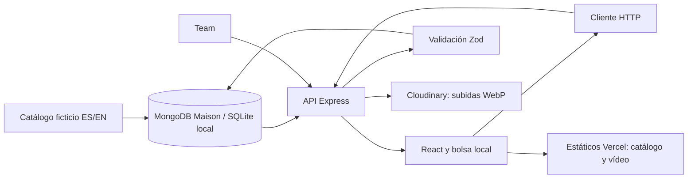
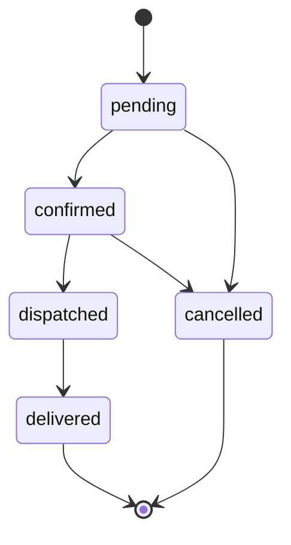
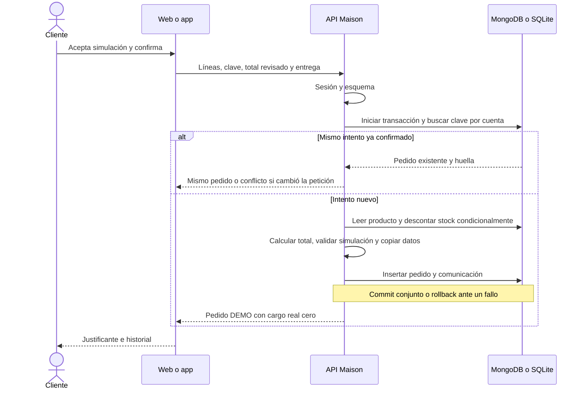

# Arquitectura y reglas de KelseTS Maison

Maison tiene una web React y una API Express. El destino elegido es Vercel con MongoDB y Cloudinary propios, siguiendo el patrón de Cars. SQLite permanece como modo local independiente. La web y la API están publicadas en Vercel; se han comprobado Atlas y Cloudinary reales y un recorrido HTTP de Team y pedido por HTTPS. Los tests aislados utilizan un replica set temporal de MongoDB. Los cambios de stock, pedidos y comunicaciones comparten una transacción. El objetivo es conservar un recorrido de demostración consistente incluso cuando se repite una petición o cambia el catálogo.

## Recorrido de datos

## Modelos

| Modelo      | Responsabilidad                                                                  |
| ----------- | -------------------------------------------------------------------------------- |
| users       | Perfil, correo normalizado, hash de contraseña y rol                             |
| sessions    | Hash del token de sesión, cuenta y caducidad                                     |
| products    | Datos editoriales ES/EN, visibilidad, colección, imagen y revisión               |
| variants    | Identificador, producto, etiqueta ES/EN, precio en céntimos y stock              |
| collections | Identidad editorial de cada colección                                            |
| looks       | Relación manual entre productos de una colección                                 |
| favorites   | Relación única entre cliente y producto                                          |
| orders      | Cliente, clave de idempotencia, huella de líneas, copia de datos, total y estado |
| messages    | Destinatario, pedido, textos ES/EN y fecha                                       |

MongoDB guarda documentos nativos, con variantes separadas, índices únicos para identificadores, correo, favoritos y clave de pedido por cuenta, y caducidad TTL de sesiones; además comprueba la fecha al consultar sesión. SQLite almacena los datos editoriales como JSON y las existencias en columnas numéricas, con claves foráneas, WAL y tiempo de espera de bloqueo. La semilla inserta solo registros ausentes; no reinicia los datos gestionados.

## Creación del pedido

1. Comprobar sesión y validar el cuerpo. No se aceptan precios del cliente, variantes repetidas ni cantidades fuera de 1–10.
2. Abrir una transacción MongoDB con sesión, lectura snapshot y escritura majority; el modo SQLite usa `BEGIN IMMEDIATE`.
3. Buscar un pedido de esa cuenta con la misma clave. Si sus líneas coinciden, devolverlo; si no, responder conflicto.
4. Leer cada variante y comprobar que su producto siga activo. Descontar con una actualización condicionada a `stock >= quantity` y actualizar la revisión del producto.
5. Copiar nombres, imagen, variante y precio; calcular subtotales y total en céntimos.
6. Insertar el pedido y su mensaje. Confirmar el conjunto o revertirlo si falla cualquier paso.

La huella se calcula con SHA-256 sobre las líneas ordenadas por identificador y, cuando hay pago simulado, también incluye el método, resultado, entrega y total revisado. La clave no se reutiliza para una bolsa distinta. El navegador conserva la misma clave si reintenta un pedido sin cambiar sus líneas.

## Estados

`dispatched` y `delivered` son estados de simulación. Una cancelación restaura el stock de las líneas una vez. No hay reapertura ni cancelación posterior al envío. Team no puede eliminar una variante necesaria para cancelar un pedido abierto.

## Ediciones de Team

La ficha devuelve una revisión. El editor la envía junto con el producto completo; la API rechaza una revisión desactualizada. Tanto una edición como un pedido o una cancelación incrementan ese número. Esto evita que una pantalla antigua reponga sin querer unidades vendidas después de abrirla.

Crear y editar productos exige textos ES/EN, una colección existente, variantes con identificadores únicos y una imagen del catálogo o una subida registrada por Maison. Ocultar un producto conserva sus datos y las copias de los pedidos anteriores.

## Acceso y privacidad

- Sesión con token aleatorio de 32 bytes y cookie HttpOnly, SameSite=Lax; Secure en producción.
- La base guarda el hash SHA-256 del token. La sesión caduca en siete días y cerrar sesión revoca el token.
- Contraseñas con `scrypt`, sal aleatoria de 16 bytes y clave de 64 bytes. No aparecen en respuestas públicas.
- La API consulta el rol vigente en cada petición. Registrar una cuenta no admite el campo `role`.
- Pedidos, mensajes y favoritos se filtran por la cuenta de sesión; consultar el pedido de otra cuenta devuelve 404.
- Las peticiones de escritura requieren `X-Maison-Request: 1`. Un origen ajeno se rechaza; no se habilita CORS. Helmet aporta cabeceras y una CSP.
- Límites por IP para API y acceso. Detrás de proxy, `TRUST_PROXY=1` solo corresponde a un salto de proxy confiable.

## Imágenes

Team puede subir JPG, PNG o WebP de hasta 4 MiB, dejando margen para multipart en Vercel. Se comprueba la firma y se decodifica con Sharp, con un límite de veinte millones de píxeles. La imagen se orienta, limita a 1600 × 2000 y convierte a WebP; no se conservan metadatos EXIF. El nombre es aleatorio. En modo Cloudinary se guarda bajo `kelsets-maison/team` y MongoDB conserva su identificador; en modo local se guarda en un directorio ignorado por Git. No se admiten SVG subidos por usuarios.

La semilla utiliza WebP propios y conserva los SVG anteriores para referencias históricas. Los estáticos de catálogo y vídeo se publican desde la web. Las subidas Cloudinary se entregan por `/api/v1/images/:id.webp`, construyendo un destino fijo y restringido; la API verifica formato, tamaño y timeout. Si falla el registro de una nueva subida, se intenta retirarla de Cloudinary. Las imágenes anteriores no se eliminan al editar porque pueden estar en pedidos históricos. Los archivos subidos que no se asignen a productos no tienen todavía una limpieza automática; su mantenimiento es una tarea pendiente.

## Combinaciones editoriales

`POST /stylist` valida ocasión, presupuesto, paleta y exclusión de belleza. Lee únicamente looks completos y productos activos; selecciona una variante disponible por pieza, calcula el total y devuelve hasta tres combinaciones que cumplan los criterios. No reserva stock ni modifica la bolsa. Cada incorporación se realiza explícitamente en la ficha.

La respuesta identifica el modo utilizado. La integración de Maison Stylist está preparada y desactivada por defecto: la selección pública sigue siendo editorial hasta configurar y verificar los proveedores. La IA solo puede seleccionar y explicar combinaciones candidatas; identificadores, disponibilidad, tallas y totales se validan en el servidor. [Diseño, activación y límites](MAISON-STYLIST.md).

## Límites de esta versión

En MongoDB, `withTransaction` permite reintentar conflictos transitorios; la unicidad del pedido por cuenta resuelve duplicados concurrentes. MongoDB requiere replica set o Atlas. La semilla es explícita, no se ejecuta en cada cold start. La conexión se reutiliza por instancia y vuelve a intentarse tras un fallo inicial. El limitador en memoria no es distribuido entre funciones. No se han medido carga ni escalado en Vercel.

La API síncrona de SQLite encaja con una demostración pequeña y una sola instancia. No se han medido concurrencia de varios procesos ni cargas grandes. El almacenamiento exige disco persistente y copias coherentes de SQLite; copiar solo el archivo principal durante una escritura en WAL no basta.

No hay recuperación de contraseña, verificación de correo, pagos, envíos reales, impuestos desglosados ni tarifas de transporte. El pedido usa únicamente precios ficticios finales. Tampoco hay correo externo ni asesoría generativa activada y verificada. Existe una app nativa Expo/React Native con acceso, catálogo, outfits, bolsa, pedidos DEMO y boutiques; su validación física del recorrido privado y distribución para evaluación siguen pendientes. Cloudinary está probado con dobles y también con subida y lectura reales a través de la API de Maison.

## Referencias técnicas

- [SQLite en Node.js](https://nodejs.org/api/sqlite.html). El proyecto se ha probado con Node 22; no asume compatibilidad con todas las ramas posteriores.
- [Vite](https://vite.dev/guide/).
- [Sharp](https://sharp.pixelplumbing.com/).
- [Zod](https://zod.dev/).

## Revisión de responsabilidades · 7 de noviembre de 2026

Los textos bilingües de los estados del pedido viven en `backend/src/domain/order-messages.js`. Los adaptadores SQLite y MongoDB comparten esa política sin que MongoDB importe las rutas HTTP de pedidos. Las escrituras de pedido, stock y comunicación siguen en la misma transacción; no se ha introducido una cola de eventos ni correo externo.

`readConfig(env)` acepta una fuente explícita de configuración y usa `process.env` por defecto. Las pruebas suministran objetos independientes, sin modificar variables globales. Se validan protocolo y origen, puerto entero de 1 a 65535 y proveedores; Vercel fuerza modo de producción aunque falte `NODE_ENV`.

Las cookies que no contienen el token hexadecimal esperado se ignoran tanto al consultar sesión como al acceder o salir. Los errores inesperados emiten un mensaje de servidor genérico sin copiar el mensaje de la dependencia a logs. No hay todavía trazas distribuidas o alertas operativas.

El cliente HTTP compartido valida el sobre JSON: indicador `success` booleano y campo `data` presente en éxitos (incluido `null`, válido para una sesión no iniciada). Los errores conservan código de texto y estado HTTP; cancelar durante la lectura de JSON conserva la cancelación. Esto valida el sobre, no todos los campos de cada entidad ni la seguridad completa del servidor.

### Secuencia de confirmación DEMO

## Sesión nativa persistente · implementación local del 7/11

La prueba física detectó pérdida de autenticación al cerrar Expo Go completamente. Se incorpora un transporte nativo explícito para el mismo token opaco y la misma tabla de sesiones, sin introducir JWT ni guardar contraseñas.

`POST /api/v1/auth/native/register` y `/auth/native/login` validan los mismos datos, permisos y límite de intentos que el acceso web. Devuelven `{ user, token }` solo después de verificar el registro o la contraseña. No existe un endpoint para convertir una cookie HttpOnly activa en un token legible. Las respuestas llevan `Cache-Control: no-store` y el servidor conserva únicamente el hash del token.

El cliente móvil almacena solo el token en Expo SecureStore, con accesibilidad iOS `WHEN_UNLOCKED_THIS_DEVICE_ONLY`; la app no utiliza biometría para este flujo. Al arrancar, restaura el token y consulta `/auth/me` antes de mostrar la cuenta. No acepta una cookie de navegador como sustituto de ese token en la restauración. Las peticiones incluyen `Authorization: Bearer …` por cabecera, nunca por URL. El servidor consulta identidad, rol y caducidad vigentes; un Authorization malformado no cae en otra identidad de cookie.

Cerrar sesión revoca el token en servidor y retira la copia local. Una sesión caducada se descarta al consultar identidad. Las operaciones de almacenamiento están serializadas; una escritura fallida no publica una identidad como autenticada y se intenta revocar el token recién emitido que no pudo guardarse. Los errores del almacén se presentan sin valores privados. AsyncStorage continúa guardando solo identificadores y cantidades de bolsa, nunca token o contraseña.

La web conserva la cookie HttpOnly, Secure en producción y SameSite=Lax. Se comprueban ambos adaptadores, permisos, expiración, rotación/revocación y límite compartido entre login web y nativo. Los dobles de almacenamiento prueban restauración y errores; no sustituyen el cierre y reapertura en teléfono. Esta implementación debe publicarse y verificarse físicamente antes de declararla cerrada.

Fuentes oficiales consultadas el 7/11: [SecureStore](https://docs.expo.dev/versions/v58.0.0/sdk/securestore/) y [limitaciones de cookies en React Native](https://reactnative.dev/docs/network#known-issues-with-fetch-and-cookie-based-authentication). SecureStore está incluido en Expo Go y usa almacenamiento protegido por plataforma; sus límites no equivalen a una garantía contra un dispositivo comprometido.

## Maison Stylist · integración desactivada

`stylist/editorial.js` aplica las restricciones compartidas. El servicio construye una lista de hasta doce candidatos, consulta Gemini → Claude → OpenAI ante fallos técnicos y valida la respuesta mediante Zod. Cada consulta utiliza un contador diario persistente antes de salir al proveedor; MongoDB usa una actualización condicional atómica sobre el mismo documento de día y SQLite un UPSERT condicional. Tras la respuesta se vuelve a leer el catálogo.

Los adaptadores HTTP tienen destinos fijos, rechazan redirecciones, acotan tiempo, salida y cuerpo recibido y no incorporan herramientas externas ni acceso a cuentas o pedidos. No se cambia de modelo tras negativas o respuestas inválidas. La interfaz distingue modo editorial e IA, muestra el proveedor que respondió y pide acceso para la asesoría IA. En producción sigue apagada hasta configurar claves y ejecutar ensayos reales autorizados. No es un sistema multiagente ni un agente con autonomía de compra.
