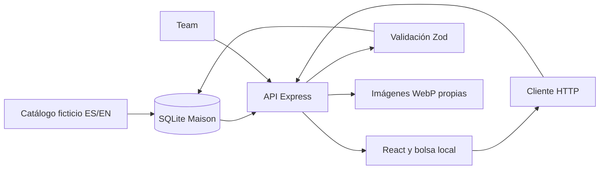
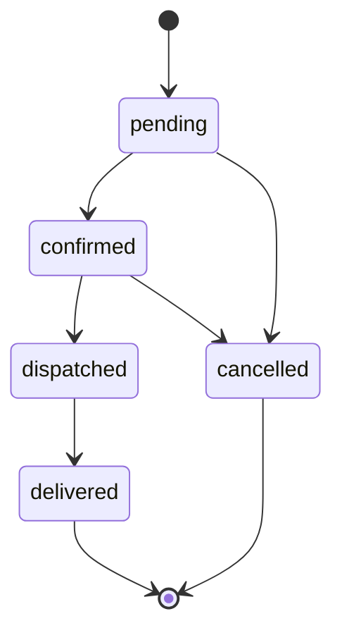

# Arquitectura y reglas de KelseTS Maison

La primera versión es una web React con una API Express y una base SQLite independiente. Los cambios de stock, pedidos y comunicaciones comparten una transacción. El objetivo es conservar un recorrido de demostración consistente incluso cuando se repite una petición o cambia el catálogo.

## Recorrido de datos

## Modelos

| Tabla       | Responsabilidad                                                                  |
| ----------- | -------------------------------------------------------------------------------- |
| users       | Perfil, correo normalizado, hash de contraseña y rol                             |
| sessions    | Hash del token de sesión, cuenta y caducidad                                     |
| products    | Datos editoriales ES/EN, visibilidad, colección, imagen y revisión               |
| variants    | Identificador, producto, etiqueta ES/EN, precio en céntimos y stock              |
| collections | Identidad editorial de cada colección                                            |
| looks       | Relación manual entre productos de una colección                                 |
| favorites   | Relación única entre cliente y producto                                          |
| orders      | Cliente, clave de idempotencia, huella de líneas, copia de datos, total y estado |
| messages    | Destinatario, pedido, textos ES/EN y fecha                                       |

Los datos editoriales se almacenan como JSON y las existencias tienen columnas numéricas propias. La base activa claves foráneas, WAL y un tiempo de espera de bloqueo. La semilla inserta solo registros ausentes; no reinicia los datos gestionados.

## Creación del pedido

1. Comprobar sesión y validar el cuerpo. No se aceptan precios del cliente, variantes repetidas ni cantidades fuera de 1–10.
2. Abrir `BEGIN IMMEDIATE`.
3. Buscar un pedido de esa cuenta con la misma clave. Si sus líneas coinciden, devolverlo; si no, responder conflicto.
4. Leer cada variante y comprobar que su producto siga activo. Descontar con `UPDATE ... WHERE stock >= quantity` y actualizar la revisión del producto.
5. Copiar nombres, imagen, variante y precio; calcular subtotales y total en céntimos.
6. Insertar el pedido y su mensaje. Confirmar el conjunto o revertirlo si falla cualquier paso.

La huella se calcula con SHA-256 sobre las líneas ordenadas por identificador. La clave no se reutiliza para una bolsa distinta. El navegador conserva la misma clave si reintenta un pedido sin cambiar sus líneas.

## Estados

`dispatched` y `delivered` son estados de simulación. Una cancelación restaura el stock de las líneas una vez. No hay reapertura ni cancelación posterior al envío. Team no puede eliminar una variante necesaria para cancelar un pedido abierto.

## Ediciones de Team

La ficha devuelve una revisión. El editor la envía junto con el producto completo; la API rechaza una revisión desactualizada. Tanto una edición como un pedido o una cancelación incrementan ese número. Esto evita que una pantalla antigua reponga sin querer unidades vendidas después de abrirla.

Crear y editar productos exige textos ES/EN, una colección existente, variantes con identificadores únicos y una imagen local. Ocultar un producto conserva sus datos y las copias de los pedidos anteriores.

## Acceso y privacidad

- Sesión con token aleatorio de 32 bytes y cookie HttpOnly, SameSite=Lax; Secure en producción.
- La base guarda el hash SHA-256 del token. La sesión caduca en siete días y cerrar sesión revoca el token.
- Contraseñas con `scrypt`, sal aleatoria de 16 bytes y clave de 64 bytes. No aparecen en respuestas públicas.
- La API consulta el rol vigente en cada petición. Registrar una cuenta no admite el campo `role`.
- Pedidos, mensajes y favoritos se filtran por la cuenta de sesión; consultar el pedido de otra cuenta devuelve 404.
- Las peticiones de escritura requieren `X-Maison-Request: 1`. Un origen ajeno se rechaza; no se habilita CORS. Helmet aporta cabeceras y una CSP.
- Límites por IP para API y acceso. Detrás de proxy, `TRUST_PROXY=1` solo corresponde a un salto de proxy confiable.

## Imágenes

Team puede subir JPG, PNG o WebP de hasta 5 MB. Se comprueba la firma y se decodifica con Sharp, con un límite de veinte millones de píxeles. La imagen se orienta, limita a 1600 × 2000 y convierte a WebP; no se conservan metadatos EXIF. El nombre es aleatorio y se guarda en un directorio propio ignorado por Git. No se admiten SVG subidos por usuarios.

La semilla utiliza SVG originales y controlados desde el repositorio. Los archivos subidos que no se asignen a productos no tienen todavía una limpieza automática; su mantenimiento es una tarea pendiente.

## Combinaciones editoriales

`POST /stylist` valida ocasión, presupuesto, paleta y exclusión de belleza. Lee únicamente looks completos y productos activos; selecciona una variante disponible por pieza, calcula el total y devuelve hasta tres combinaciones que cumplan los criterios. No reserva stock ni modifica la bolsa. Cada incorporación se realiza explícitamente en la ficha.

La respuesta identifica `mode: editorial`. No existe una integración de IA en esta versión. Un proveedor futuro deberá someter identificadores, disponibilidad y totales a estas mismas reglas del servidor.

## Límites de esta versión

La API síncrona de SQLite encaja con una demostración pequeña y una sola instancia. No se han medido concurrencia de varios procesos ni cargas grandes. El almacenamiento exige disco persistente y copias coherentes de SQLite; copiar solo el archivo principal durante una escritura en WAL no basta.

No hay recuperación de contraseña, verificación de correo, pagos, envíos reales, impuestos desglosados ni tarifas de transporte. El pedido usa únicamente precios ficticios finales. Tampoco hay correo externo, Cloudinary, integración de IA ni app nativa.

## Referencias técnicas

- [SQLite en Node.js](https://nodejs.org/api/sqlite.html). El proyecto se ha probado con Node 22; no asume compatibilidad con todas las ramas posteriores.
- [Vite](https://vite.dev/guide/).
- [Sharp](https://sharp.pixelplumbing.com/).
- [Zod](https://zod.dev/).
