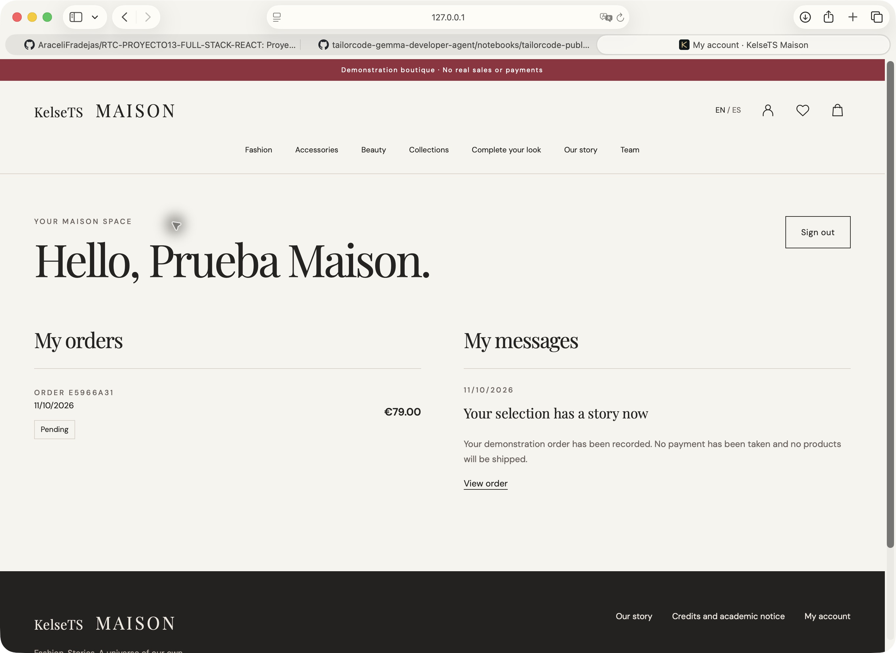
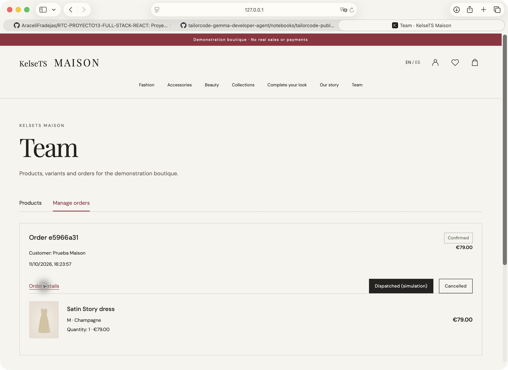

# Evidencias de Maison

La selección de la versión publicada está en [Capturas de producción del 18 de octubre de 2026](produccion-2026-10-18/README.md): portada, catálogo, ficha, cuenta y Team, con pies y límites de cada evidencia.

## Archivo histórico · Safari local

Capturas del **11 de octubre de 2026**, tomadas en Safari sobre la aplicación local. La cuenta «Prueba Maison», el pedido y sus datos son ficticios. Estas capturas preceden al ajuste del logo KelseTS aplicado después; los estados del pedido son los observados durante la prueba. Las imágenes muestran comprobaciones parciales del recorrido, no una certificación general del sistema.

## Cuenta en inglés

La cuenta muestra el pedido de demostración por 79 €, su estado pendiente y la comunicación que identifica la ausencia de cobro y envío. La variante elegida fue M · Champagne. Se había cambiado a inglés desde la bolsa sin perder la selección.

## Gestión del pedido

Team muestra el mismo pedido confirmado, su detalle y las acciones permitidas de simular envío o cancelar. El precio y la variante coinciden con el recorrido del cliente.

## Pendiente de ampliar

La nueva selección publicada incorpora portada, catálogo, ficha, cuenta y Team en castellano. Quedan por ampliar bolsa, editor de producto, subida de imagen, inglés de la versión publicada y dispositivo real. La relación de pruebas ejecutadas y sus límites está en [Validación](../VALIDACION.md).

## Láminas de catálogo · 17 de octubre

Estas imágenes son láminas de contacto compuestas con Sharp a partir de los recursos de producto; no son capturas del navegador. Muestran las 190 imágenes principales con sus identificadores y nombres musicales para revisar la correspondencia visual a escala de miniatura. No acreditan todas las fichas ni todos los tamaños de pantalla.

- [Productos 1–30](catalogo/catalog-1.jpg).
- [Productos 31–60](catalogo/catalog-2.jpg).
- [Productos 61–90](catalogo/catalog-3.jpg).
- [Productos 91–120](catalogo/catalog-4.jpg).
- [Productos 121–150](catalogo/catalog-5.jpg).
- [Productos 151–180](catalogo/catalog-6.jpg).
- [Productos 181–190](catalogo/catalog-7.jpg).
